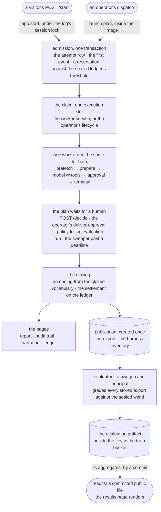
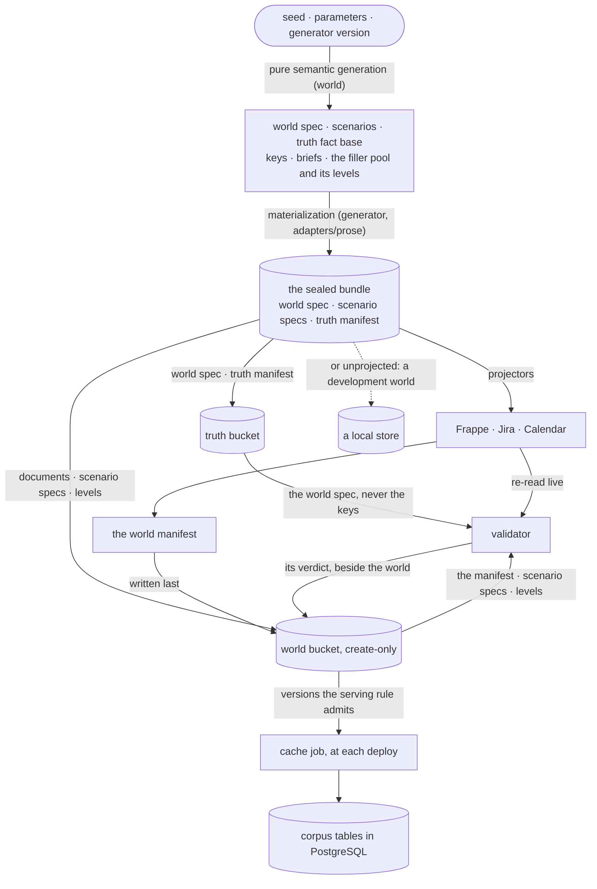

# ARCHITECTURE — leave-impact-agent

How it's built and why that structure: a snapshot of the tree as it stands, edited in
place. Decisions and their rationale live in DESIGN (cited here by name); the pitch in
README. How each part came to its shape is in git and in the as-built passages of the
design record, DESIGN_RECORD, not here.

*Snapshot at the demo milestone's close · last updated 2026-11-10 · eleven packages
under `src/leaveimpact`.*

An LLM agent reads an organization's HR system, issue tracker, calendar and documents,
works out which deadlines and meetings a leave affects and who can cover them, and
drafts a coverage plan for a person to approve. An agent's answer about a leave can
only be graded if the right answer is known, so the organization is generated together
with its answer key and the key is sealed where the agent cannot reach it. The model
never concludes: it reports facts with the text they came from, and deterministic rules
draw every conclusion, which is also what makes the grading exact.

[The life of a run](#the-life-of-a-run) · [Design shape](#design-shape) ·
[The life of a world](#the-life-of-a-world) · [Where state lives](#where-state-lives) ·
[What runs where](#what-runs-where) ·
[Key abstractions and seams](#key-abstractions-and-seams) ·
[Module responsibilities](#module-responsibilities) · [Tests](#tests) ·
[Structural stories](#structural-stories) ·
[Deliberately not done](#deliberately-not-done-restraint)

---

## The life of a run

What happens inside the work order, and where each part lives:

| | what happens | where it lives |
|---|---|---|
| **prefetch** | the structured records of the HR system, the tracker and the calendar, read once and then fixed for the run | `core.prefetch`: the frozen prefetch as data with its planner and digest |
| **read** | the model reads in turns, through tools scoped to its role and a full-text search over document sections | `core.tools`: the fourteen read tools as declarations, the roles, validation, the surface digest · `agent.execution`: the one path for a declared tool call |
| **state facts** | a loop turn shows the model the role's read tools and the fact tool; the model reads, and may state facts about what earlier turns returned. Then one finalization call, requested and never guaranteed, the fact tool alone and forced by name, so the last turn can only state facts | `agent.turns` · `core`'s `stated`, `anchors`, `binding`, `admission`, `stated_view`: what a model says a text asserts, and the gates that decide whether it enters the view |
| **rules conclude** | deterministic rules compose every claim and the coverage plan from the facts that pass the checks | `agent.composer`: from a run's reads and the admitted statements to claims |
| **approval** | a run with a human approver waits: a visitor's POST /decide, or the operator's `deliver-approval`; an evaluation run is approved by policy | `app.decide` · the `agent` command `deliver-approval` · the approval policy in `agent.worker` |
| **every step** | an event the pure transition admitted, appended under the attempt row's lock, the graph's checkpoints beside it | `agent.log_events`: seventeen kinds, closed · `agent.log_transition`: the one function that says which event may follow, and the state it folds to · `agent.graph`: the six-node skeleton |
| **every model call** | counted, authorized against the run's account, dispatched and attributed; nothing retries beneath a dispatch, so asking a call again is the harness's own decision, under the registered re-dispatch policy | `agent.graph` over `core`'s `run_account`, `call_decision`, `input_bound` and `attribution` · a run's reservation is the most its dispatches can cost under the caps (DESIGN, "A dispatch's worst case is written into its intent") |

The same path with every module and command named

    a visitor's POST /start                         an operator's dispatch
        │  app.start, under the log's session lock      │  launch plan, inside the image
        │  for the demo's ledger: the recorded          │  on the instance: the frozen
        │  request, the flag, the address window,       │  inputs from the registration,
        │  the day's cap, one open run; the frozen      │  the price table, the cell and
        │  inputs from launch.demo                      │  the scenario
        ▼                                               ▼
    admission (agent.log_store, one transaction): the attempt row, the first event, a
    reservation against the shared ledger's threshold
        ▼
    the claim: one execution slot in the store, locked by every claim from either path
        ├── the worker service (app.worker, its own container): each tick the sweeper's
        │   pass, then the one attempt due, worked in a child process the service can
        │   terminate, kill and reap
        └── the operator's lifecycle (deploy/instance/lifecycle.sh): one command a word
        ▼
    one work order (agent.work_order → agent.worker → agent.graph), the same for both:
    prefetch → prepare → model ⇄ tools → approval → terminal
        │  reads go through the read ports (Frappe, Jira, Calendar, the corpus cache);
        │  a model call is counted, authorized against the run's account, dispatched
        │  (one send a dispatch) and attributed; every step is an event the pure
        │  transition admitted,
        │  appended under the attempt row's lock, the graph's checkpoints beside it
        ▼
    the plan waits for a human: POST /decide (app.decide) approves or declines; an
    evaluation run is approved by policy; the sweeper closes a wait past its deadline
        ▼
    the closing: an ending from the closed vocabulary, the settlement on the ledger
        ├──► the pages (app), every read through one admission: the report and the audit
        │    trail from the export the closed log folds to, the narration from the
        │    log's events (as a timeline and as server-sent events), the ledger page
        │    from the ledger's entries
        └──► publication (the agent's publish and inventory commands, run by the
             lifecycle or by the sweeper): the export and the harness inventory,
             created once under the world bucket's runs prefix
                 ▼
             evaluator (its own job, under its own principal): proves the sealed
             world, grades every stored export against it, and writes the evaluation
             artifact beside the key in the truth bucket
                 ▼
             results: the artifact's aggregates as a committed public file, which the
             results page renders; the artifact itself is never decoded

The agent writes a run once and the evaluator grades it; neither may import the other,
so everything both must read the same way lives in `core`: the claim vocabulary, the
rules, the tool declarations, the prefetch, the registration, the run export and its
codec, the account and eligibility rules. The harness runs a `core` function and the
evaluator's audit replays the same one over the export.

---

## Design shape

One package per responsibility, ranked; a module imports only its own package or a
lower rank, and a few edges are denied on top of the ranks because they cross a trust
boundary the ranks alone would permit. One line per package, what it imports:

    rank 4   app        →  agent, results, adapters, core     the demo surface and its worker
             launch     →  agent, world, adapters, core       admissions for an operator's run
    rank 3   agent      →  adapters, core                     the investigator, its baselines, the run log
             evaluator  →  world, results, adapters, core     grading against the sealed truth
             validator  →  world, adapters, core              read-only check of a projected world
             generator  →  world, adapters, core              causes a world, then seals it
             cache      →  world, adapters, core              the corpus cache job on the instance
    rank 2   adapters   →  world, core                        one external boundary per subpackage
    rank 1   world      →  core                               the benchmark, pure
             results    →  core                               the public results schema, pure
    rank 0   core       →  nothing inside the package         the domain, pure

The package root holds two files and no rank: the package docstring and `__main__`, the
image's command and the one composition root that may name packages of every rank.

The rules, stated once:

- **Downward only.** A module never imports a higher rank, and the five rank-3 shells
  never import one another: the generator cannot reach the validator or the evaluator,
  so read-only and non-echo are properties of the graph.
- **The investigator and the page are blind to the benchmark.** `agent` and `app` never
  import `world`, `generator`, `validator` or `evaluator`: the answer key is unreachable
  at source level, not only by credential. `cache` and `launch` are denied the three
  benchmark jobs and read `world` for its codecs alone: sealed documents and levels in
  the cache job, the scenario specification (the question a run is asked) in the
  launcher.
- **The domain does not know synthetic worlds exist.** `core` never imports `world`.
  The two hold different kinds of things, what the real system believes and what exists
  only because the world is constructed, and the production investigator should depend
  on the first without depending on the second. A merged package would keep the files
  apart and lose the property.
- **Pure below the adapters.** `core` and `world` perform no I/O, read no clock and
  take no credential or configuration; a job's values are parsed, typed and named once
  at its `entrypoint` and passed down as plain data. `results` is pure but for one
  read: `committed` loads the package's own committed file by package name.

Five more rules: one adapter per boundary, identity at composition, writing as a module path, the answer key's named readers, explicit world time

- **One adapter, one external boundary.** Sibling adapters never import one another; a
  helper they share sits at the `adapters` level (`transport`: the HTTP session under
  the retry rule, where a request declares whether it is replayable). An adapter
  translates vendor shape to `core` types and never launders a fact.
- **Identity at composition.** An adapter takes a credential; it never embodies a
  principal.
- **Writing is a module path.** The vendor write ports (`core/ports/write`) and the
  object store's writers are imported only by `adapters` and `generator`, the corpus
  cache's loader only by `adapters` and `cache`; the validator, the evaluator, the
  investigator and the page are readers by construction. The readers are re-exported
  from `core`; the writers are not.
- **The answer key has named readers.** `world.truth_decoder`, the one decoder of the
  truth manifest, is imported only by the modules the law names by full path: the
  generator's resume, the evaluator's world loading and the audit-sheet script. This
  gate alone scans the operator's programs under `scripts` and `probes` beside the
  package, and a named reader that no longer imports the decoder fails as a stale
  grant.
- **World time is explicit.** `RunContext` carries `now`; the wall clock is read only at
  a composition root named by path (the package root, the surface's command line, the
  worker's healthcheck) and converted into context at once. The run log reads the
  database's clock and never the machine's.

`tests/unit/test_import_law.py` holds some of these rules as tests and not others:

| held by the import law's tests | held by contract or in review, by no test |
|---|---|
| the ranks | an adapter launders no fact |
| the lateral shells | an adapter embodies no principal |
| the denied edges | no configuration reaches `core` |
| sibling adapters | the loop's framework is contained inside `agent` |
| the write gate | `app` and `launch` do not import one another |
| the truth decoder's readers | `world` and `results` do not import one another |
| a list of I/O libraries banned from the pure packages | |
| the wall clock's roots | |

The last two separations are held by the packages' contracts because the law refuses a
lateral import among the rank-3 shells only. The surface gets the demo's planner from
`launch` through the package root, which imports both.

The rules that keep the law from failing open

- Every package under `src` must hold a rank.
- Relative imports are banned because the edge scan cannot rank them.
- The top level holds only the two files above, so no unranked module can launder an
  edge.
- An import is read with its aliases.
- A name re-exported through a permitted package is followed to the module that
  defines it, the written edge kept beside the resolved one.
- An import that binds the bare package name and a star import from inside the package
  are banned, since the scan can rank neither.
- The writer gate's module scope is every statement that runs at import time, class
  bodies included.

### The life of a world

The world version is the hash of the bundle's three artifacts, in order. A manifest in
the world bucket marks a completed projection, and the cache job serves a version only
when the current validator approved it.

The same path with every object and writer named

    seed + parameters + generator version
        │  pure semantic generation (world)
        ▼
    world spec · scenarios · truth fact base · keys · briefs · the filler pool, minted
    last, with the levels that cut into it
        │  materialization (generator ← adapters/prose): templates, model-written prose,
        │  the containment gate; accepted text frozen, failures discarded
        ▼
    the sealed bundle: world spec · scenario specs · truth manifest
    world version = the hash of the three, in order
        ├──► truth bucket: the world spec (validator and evaluator) and the truth
        │    manifest (evaluator only); the application reads neither
        ├──► projectors (generator ← adapters) → Frappe · Jira · Calendar
        │        └──► the world manifest (adapters/manifest): the resolved adapter
        │             configuration, one locator per projected id, the world version
        │             and digests; the projection's receipt and checkpoint, staged
        │             preparing → projected, written after the vendors mint ids;
        │             outside the world version, its digest named by the verdict
        ├──► world bucket, create-only: the documents, the scenario specs, the levels,
        │    and the manifest last, so a manifest marks a completed projection
        └──► or, unprojected (a development world): the truth pair, the documents and
             the specs into a local store the repository ignores, the levels object
             last as the completion record, no manifest; the planted readers
             (adapters/plantings) present the spec as the three systems to the
             benchmark's own principals, never to the application
        ▼
    validator: re-reads the live systems, re-derives the structured expectations and
    compares them with the world spec; reads the spec and the systems, never the keys;
    its verdict lands beside the world
        ▼
    cache job (on the instance, at each deploy): admits each version under the serving
    rule (a completed projection approved by the current validator) and fills the
    corpus tables in PostgreSQL from the sealed documents

The seed identifies the semantic specification; the frozen bundle identifies the
realized world (DESIGN, "Truth before prose"). Every later artifact, a run's export or
an evaluation, records the world version and the truth digest, so a number months later
is the same question about the same world.

### Where state lives

| store | holds | written by |
|---|---|---|
| Frappe, Jira, Google Calendar | the organization as its systems of record hold it | the generator's projectors; every other principal reads |
| PostgreSQL on the instance | the run log (attempt rows, events, the shared ledger, publication records) with the graph's checkpoints; the surface's own tables (publishable attempts, live rows); the corpus cache | `agent.log_store`; `app.store`; `adapters.corpus.loader` |
| the world bucket | sealed worlds under a create-only prefix, the mutable projection checkpoint, validator verdicts, run exports and inventories | the generator; the validator's verdict; `agent publish` |
| the truth bucket | the world spec, the truth manifest, evaluation artifacts | the generator; the evaluator |
| the repository | the registration, the price table, the public results file, the demo configuration, the released golden world under `docs/` | a commit |

Each PostgreSQL schema has one owner in the tree. `agent/log_schema.sql` and
`app/schema.sql` are applied by the deploy's two bootstrap commands, and every
connection refuses a schema version other than its code's; `adapters/corpus/schema.sql`
is applied by the cache loader, which reads the table's columns back before it loads.
The buckets' policies, the hosts,
the proxy, the backup units and the instance's first-boot configuration belong to the
platform repository; this tree consumes their names as configuration.

### What runs where

| where | process | command |
|---|---|---|
| instance, container `app` (384m) | the demo surface | `python -m leaveimpact` |
| instance, container `worker` (448m) | the worker service; one `work-one` child per attempt | `python -m leaveimpact.app worker` |
| instance, container `postgres` (192m) | PostgreSQL 16 | |
| instance, one run each per deploy | the cache job, the two schema bootstraps, the identity line | `leaveimpact.cache`, `leaveimpact.agent bootstrap-log`, `leaveimpact.app bootstrap`, `leaveimpact identity` |
| instance, one or two runs per lifecycle word | an operator's run | `leaveimpact.launch` (the plan, then the status), `leaveimpact.agent admit`, `work`, `deliver-approval`, `publish`, `inventory` |
| a GitHub runner, dispatched | generation, validation, evaluation, each under its own role | `leaveimpact.generator`, `leaveimpact.validator`, `leaveimpact.evaluator` |

One image carries every command; a job is one command per execution with no queue
between them, and the PostgreSQL log is the seam a second process continues from.

---

## Key abstractions and seams

The pure core and its shells are stated in the rules under Design shape. The seams
between them, each with its contract and what attaches to it:

| seam | contract | what attaches |
|---|---|---|
| **The read and write ports** · `core/ports` | A port returns observed entities; facts are derived inside. The import law lets only `adapters` and `generator` import `write`, so read-only is a property of the module graph rather than a promise about which methods get called. The vendor adapters are combined reader-writer classes whose capability is the type they are handed as, and the validator's read-only role for them rests on the import law's gate over the write ports and on the credential's authority. | An adapter conforms by shape and inherits nothing, and its conformance is checked by a typed assignment in its tests. |
| **The tool declarations** · `core/tools` | A tool is one typed specification naming exactly one read-port method, the model's schema generated from it, and the tool makes no domain decision. The registry declares per role which methods become tools, so a tool list is constructed and never prompted. | Everything with an effect, the port binding, the logging, the wrapper that renders a result, stays in `agent` and binds to these at the registry step. |
| **The prose seam** · `adapters/prose/seam` | The generator renders a brief into a system text and a message, names the tool it wants forced and the inference settings it wants recorded, and the adapter sends exactly that. | A change of prompt policy never touches the adapter and a change of provider never touches the generator. |
| **The object store** · `adapters/object_store` | Each backend is two classes in two modules, the module boundary being the capability boundary: `s3` and `local` hold the readers, objects with no write method on them at runtime and not only in their type. | `s3_write` and `local_write` hold the writers as subclasses, in the gated modules. |
| **The run log** · `agent/log_store`, `agent/log_transition` | An investigation is a job that appends narrated events and checkpoints to PostgreSQL. One pure function takes the attempt's state and an event and gives the next state, an idempotent receipt, or a refusal; the store runs it under the attempt's lock before every insert, and the log reader folds it over the whole log before it builds an export, so the rules are written once and nowhere as a database constraint. The read ports, the tool registry, the claim vocabulary and this seam know nothing of the framework. | The UI streams by reading that log, never by holding the worker's socket; the seam is also what makes the worker's location a deployment detail. |
| **The public results** · `results` | Three statistical families carry every figure (a yes-or-no check estimated in a cell, a ratio estimated in a cell, a paired comparison of two arms), so a new named statistic is a new row and never a new type. | The demo surface reads it and the evaluator writes into it, so the two share this contract and nothing else. |
| **The approval policy** · `agent/worker` | Who approves at the pause: the outside producer an automatic policy appends under, or `None` when a human decides later and the worker is to end its segment. | `AutomaticApproval` is the measurement convention; `HumanApproval` is a human deciding outside the process. |

---

## Module responsibilities

Signatures and contracts live in the docstrings, rendered by `scripts/regen_docs.py`;
this section is the map. Modules are grouped by concern, each named once. One fold per
package.

<b><code>core</code></b> — the domain, pure

What the real system believes, with no knowledge that a benchmark exists, and
everything the investigator and the evaluator must read the same way.

- **The vocabulary.** `entities`, `ids`, `enums`, `values`, `refs`, `predicates` (each
  fact kind with its value, system of record and evidence domain), `facts`, `claims`
  (six typed claims with their grading keys), `skills`, `comments`, `worldtime`.
- **The deterministic rules.** `derivation` (an observed record to facts and gaps;
  its reading of a criterion is exhaustive over the closed union, so a kind added
  without a reading fails the type check), `closure`, `coverage`, `authority`,
  `grounding`, `viability`, `plans`, `checks`, `readings`, `scoping`, `contradictions`.
- **The ports.** `ports/read` and `ports/write`, four protocols each, `ports/observed`
  (an entity as a source returned it) and `ports/errors`. A port returns observed
  entities; facts are derived inside.
- **Tools and the prefetch.** `tools` (the fourteen read tools as declarations, the
  roles, validation, the surface digest), `prefetch` (the frozen prefetch as data with
  its planner and digest), `query_protocol` (the single-shot baseline's one query).
- **What a run's reads show.** `read_coverage`, `read_condition`, `read_projection`.
- **Stated facts.** `stated`, `anchors`, `binding`, `admission`, `stated_view`: what a
  model says a text asserts, and the gates that decide whether it enters the view.
- **The run as plain data.** `run_trace`, `run_record`, `run_export`, `model_calls`,
  `usage`, `call_settings`, `provenance`, `run_timing`, `run_ending`.
- **Accounting and control.** `pricing` (exact integer cost from a committed table),
  `token_counting`, `input_bound`, `counting_operations`, `run_account`,
  `call_decision`, `attribution`, `eligibility`.
- **The preregistration and the inventory.** `registration`, `inventory`.
- **Codecs.** `claims_json`, `entities_json`, `values_json`, `stated_json`,
  `run_export_json`, `run_parts_json`, `registration_json`, `timeshape`, `jsonshape`.
  One written form each; a bytes decoder accepts only what re-encodes to itself.

<b><code>world</code></b> — the benchmark, pure

Everything that exists only because the world is constructed.

- **The organization.** `org` (seed and `OrgParams` in, the organization out; a
  generation dial lives in `OrgParams` or does not exist, so a world's provenance is
  complete), `vocabulary`, `zones`.
- **The plan and its scenarios.** `plan`, `scenario`, `classes`, the three tiers
  `structured`, `fragmented` and `adversarial`, `modifiers`, `construction`, `slices`,
  `assembly` (every scenario, then the whole-world re-verification). The seed enters at
  organization generation and at assembly; assembly draws one seed per plan row and one
  for the filler pool from its own stream before it draws the construction order, and
  each row is built from its own generator.
- **Truth.** `truth_facts`, `runtime_view` (the facts a run can obtain at its run day),
  `scope` (the one matcher the generator runs at assembly and the evaluator at load).
- **Prose targets.** `prose` (what a text may claim, and the record of how a model's
  text was accepted; a proposition is a `world` type because the sealed record holds
  it), `briefs` (the typed pending targets and the pre-compose contract, which refuses
  in code a brief whose allowed context is not a fact of its world), `composition`,
  `filler`, `filler_mint`, `levels`.
- **Sealing.** `artifacts` (the three artifacts in canonical bytes, the world version),
  `decoders`, `target_records`, `truth_decoder` (gated), `disclosure`, `version`.

<b><code>adapters</code></b> — one external boundary per subpackage

- **The vendors.** `frappe`, `jira` and `calendar`, each an `adapter` over the vendor's
  REST surface and `records` for the shapes in both directions.
- **The corpus.** `corpus`: the document reader over the PostgreSQL cache, scoped to a
  world version and a level (`adapter`), the gated `loader`, `records`, `schema.sql`.
- **The models.** `prose` (the generator's writer and checker behind a request-shaped
  seam, `seam` and `bedrock`), `inference` (the investigator's Converse client and
  counting client, one send per call so every retry is the logged policy's),
  `converse` (the one translation of a tool definition to Converse's shape).
- **The object store.** `object_store`: `read` and the gated `write`, the two backends
  split by capability (`s3`, `s3_write`, `local`, `local_write`), `layout` (the key of
  every sealed object), `documents` and `documents_write`, `serving` (which versions
  the application may serve) with `verdicts`.
- **Beside them.** `transport`, `filestore` (one file replaced whole or not at all),
  `manifest` (the world manifest), `plantings` (a sealed world read as the three
  systems), `wiring` (the read side the composition roots share: the deployment from
  the environment, the readers built, the publication callables).

`adapters` reads `world` for the sealed artifacts' names and bytes, the levels, and the
organization parameters and generator version a manifest records; `plantings` alone
reads a world spec's planted records, and nothing here reads a key.

<b><code>generator</code></b> — causes a world, then seals it

- **The prose stage.** `materialize` (the attempt loop over every pending brief:
  briefs run on a small thread pool and merge in brief order, so the record is the same
  at any worker count; a cap exhausted marks its target and the stage reports every
  failed target together; a model that cannot be used aborts the stage as
  infrastructure), `guards` (the three containment checks, pure), `checkpoint`, and
  `prose` (`assets`, `render`, `schema`: the prompt policy and the checker's tool
  generated from the predicate registry). Text a class writes itself carries its fact
  with no brief and never enters the loop. Model identifiers come from the environment
  and their absence fails the start; inference settings are code; the calls run on the
  job's ambient role and no credential is held.
- **From a recipe to a bundle.** `recipe`, `fresh`, `resume` (a named reader of the
  truth decoder).
- **Projection and sealing.** `projection`, `realize` (prepare, checkpoint, project,
  prove, promote), `systems`, `manifest_store`, `sealing` (truth first, the manifest
  last, every object read back).
- **The job.** `entrypoint`, `metrics`, `probe`, `__main__`.

<b><code>validator</code></b> — read-only verification of a projected world

`verify` (inputs authenticated, systems read, checks run), `checks` (identities,
records, the view of a run, as pure comparisons), `verdict` (its own artifact, approved
only when every check passed), `entrypoint`, `__main__`. It reads the world spec and the
live systems and never a key.

<b><code>evaluator</code></b> — grades recorded runs against the sealed truth

Never re-reads a vendor; grounding is `core`'s rules replayed over a run's own reads.

- **The world a run is graded against.** `sealed_world` (the three sealed files joined
  and proven, every key reproduced), `world_index`, `oracle` (what the rules conclude
  under a condition over runtime truth), `characterization`.
- **The grade.** `rows`, `matching`, `plan_checks`, `plan_reading`, `grading` (one
  outcome per export: graded, limited or excluded).
- **What a run's reads support.** `observed_view`, `replay`, `grounded`, `citations`.
- **What a run did.** `trace_metrics` over `source_discipline`, `cost_check`,
  `prefetch_conformance`, `membership_conformance`, `proof_contribution`,
  `retrieval_targets`, `retrieval`, `fact_recheck`, `level_check`, `fact_stages`,
  `ending_check`, `attribution_check`, `account_check`, `count_check`, `call_check`,
  `eligibility_check`: each audit on the `core` function the harness ran.
- **Tables.** `cells`, `measures`, `evidence_measures`, `mechanism`, `intervals`
  (Wilson and the seeded tier-stratified bootstrap), `tables`, `diagnostics`,
  `headroom`, `incidents`.
- **Under the registration.** `attempts`, `run_checks`, `registered`, `analysis` (every
  registered table in one pure pass), `harness_inventory`.
- **The artifact and what is published of it.** `artifact`, `artifact_json` (an
  encoder, no decoder), `public_results`, `public_acceptance`, `public_crawl`.
- **The job.** `repository`, `entrypoint`, `__main__`.

<b><code>agent</code></b> — the investigator, its baselines and the run log

The systems the benchmark measures, over the read ports alone; the loop's framework is
contained inside this package.

- **Reads and composition.** `execution` (the one path for a declared tool call),
  `conclusion`, `composer` (from a run's reads and the admitted statements to claims),
  `report`, `fact_entries`, `rules_only`, `export`, `approval`.
- **The model systems' content.** `assets`, `surface` (what the model sees of its
  reads), `corpus`, `turns`, `admissions`, `request_parts`, `one_call`, `preparations`.
- **Under the registration.** `registered` (a run's provenance read from the
  preregistration, so nothing it fixes reaches a run from a literal).
- **The run log, pure.** `log_events` (seventeen kinds, closed), `log_transition` (the
  one function that says which event may follow, and the state it folds to),
  `log_ending`, `log_reader` (a closed log to its export), `answer_parse`, `ledger`,
  `inventory`.
- **The run log, stored and driven.** `log_store` with `log_schema.sql` (the attempt
  row's lock, admission as one transaction, the claim, the append, the closing with its
  settlement, the ledger), `appender`, `graph` (the six-node skeleton), `worker` (one
  process's ownership of one attempt), `work_order` (the composition every root
  performs), `commands`, `__main__`.

<b><code>launch</code></b> — admissions for an operator's run

`plan` (the frozen inputs of a run, the work line's flags, the next step of the
lifecycle from an attempt's state), `demo` (the same inputs for a visitor's run),
`__main__`. The host and runner sides of the lifecycle are shell:
`deploy/instance/lifecycle.sh` and `deploy/runner/investigate.sh`, read by fake-binary
tests and by shellcheck in CI.

<b><code>cache</code></b> — the corpus cache job

`job` (discover, admit by the serving rule, read, verify against the manifest, load,
demote what the rule no longer serves), `__main__`.

<b><code>results</code></b> — the published results, pure

`public` (what a results page may show of a measurement: aggregates, nothing per
scenario, no digest of the measurement world's sealed objects), `codec`, `committed`.
The surface reads it and the evaluator writes into it, since neither may import the
other.

<b><code>app</code></b> — the demo surface and its worker

FastAPI with server-side templates behind the platform's proxy. Store access is
synchronous on the thread pool with nothing held open while a browser waits; Pydantic
parses HTTP input only.

- **Configuration and names.** `config` (the served world as an allowlist of one, the
  registered system, the ledger, the caps and bounds, the live flag), `public`, `live`,
  `roles`, `amounts`, `markup`.
- **The stores and the one admission.** `store` with `schema.sql`, `read_model` (a
  projection for the listing, a log-checked resolution for content), `publishing`,
  `publication_check`, `ready`.
- **The live path.** `start`, `decide`, `window`, `sweeper` (one pure function from a
  snapshot to actions, each performed through the agent's commands), `worker` (the
  single-flight service and its supervised child), `heartbeat`.
- **The pages.** Pure view functions over an export, a log or a committed file:
  `report`, `trail`, `narration`, `results`, `ledger_page`, `walkthroughs`; templates
  format nothing themselves. `stream` serves the narration as server-sent events, an
  asynchronous generator over short synchronous reads.
- **Operations.** `restore` (what a restored scratch database must show before a
  backup counts as recoverable), `main` (the routes and the application factory),
  `__main__` (bootstrap, publish, verify-restore, verify-publications, sweep, worker,
  worker-health, work-one).

### What is versioned

Each persisted form carries a version, and a reader names the set it accepts.

The versions as they stand

| form | version | read |
|---|---|---|
| the run log's events | 4 | 3 and 4 |
| the run export | 4 | 3 and 4 |
| the harness inventory | 2 | 1 and 2 |
| the registration | 5 | one written form, strict |
| the evaluation artifact | 10 | written, never decoded |
| the run log's schema · the surface's schema | 6 · 3 | advanced by the bootstrap, checked on every connection |
| the generator | 19 | a world records the version that sealed it |

## Tests

Levels are markers, and the default run is everything unmarked: the files of
`tests/unit` and every module's doctests, the network blocked. The import law and the
disclosure gate enumerate the tree, so an edit anywhere can fail them.

The other levels, and where the in-memory ports live

`integration` runs over the PostgreSQL service and recorded cassettes; `crash` is the
crash matrix, child processes killed at named crossings, in a CI job of its own; `slow`
is the twenty-seed sweeps of the generator's invariants, two files of `tests/unit` in a
CI job beside the gate; `live` runs only against a real sandbox and is selected by
hand; `e2e` is declared and holds no test. One test pins the set of built scenario
classes that no offered plan names; the set is empty today.

In-memory implementations of both sides of a port live under `tests`; an
`adapters/memory` package would call memory an external system.

---

## Structural stories

### A rank law alone would have let the investigator read the answer key

**Denied edges sit above the ranks.** The first cut of the layout was a plain rank
order, `world` at rank 1 and `agent` at rank 3, which made `from leaveimpact.world
import truth` a legal import in the investigator. Credentials would still have kept the
truth bucket out of reach at run time, but the whole answer-key design (DESIGN, "Keeping
the benchmark out of the product") rests on the agent working only from what landed in
the systems,
and a boundary that only the deployment enforces is a boundary the test suite cannot
see. The law therefore has two parts: ranks for the default direction, and an explicit
denied-edge table for the trust boundaries. The same reasoning promoted the validator
to its own package: inside `generator`, nothing could have stopped a validator module
from importing a projector, and "read-only" would have been a comment.

### A one-day probe settled who writes the claims

A model decides what to read and states what free text asserts, each fact with its
carrier (a ticket comment or a document section) and a verbatim quote; the rules compose
every claim from the structured reads and the stated facts, and no model writes a
verdict. The question was answered by running a model against the evaluator on a
throwaway world before any harness code existed. Shown everything the run read and asked
to state prose facts with the exact words that assert each, it produced 26 of 30
scenarios correct whole on the first prompt and 30 of 30 on the second, wording written
after the misses were seen, so it is tuned on that world. The other shape was run as the
contrast: the model writes the whole report itself, and it scored 0 of 6, most answers
near misses of one to three wrong rows out of thirty or more. The contrast is partly
circular: the facts arm concludes with the same rules the oracle runs, and the authoring
arm was never told the rules. Until a fair version runs the 0 of 6 is a direction
(`REPORT_NOTES.md`, 2026-10-04). In the tree that shape is `core`'s `stated`, `anchors`, `binding`, `admission`
and `stated_view`, what a model says a text asserts and the gates that decide whether it
enters the view, and `agent.composer`, from a run's reads and the admitted statements to
claims (DESIGN, "The model states facts and the shared rules conclude").

### The log is ahead of the checkpoint and wins

The loop runs on LangGraph, and the ruling was provisional on an acceptance spike whose
must-pass checks included a process killed at each of the 82 seams of a scripted run and
recovered with the two stores reconciled and one approval event. Two things the spike showed shape the harness.
The log is ahead of the checkpoint and wins: a node looks its result up in the log
before executing, and the model request is rebuilt from the log, so what the model is
shown has to be a rendering the log reproduces byte for byte. And recovery cannot read
the framework's state alone: an empty list of next tasks also describes a step whose
writes are saved and whose checkpoint is not (DESIGN, "The acceptance spike passed").

The checkpoint thread is derived from the run, the attempt and the generation, so every
checkpoint and pending write of a fenced worker lands where no later owner reads, and
every claim starts on a fresh thread and replays from the log. The shared thread was
recommended first, on the reading that a stale checkpoint is an older cursor whose
content the log holds, and reversed because a checkpoint also holds pending task writes
the framework uses to skip tasks. Stated consequence: the saver's durability serves
inspection and the behaviour equals an in-memory saver (DESIGN, "Recovery is from the
log on a fresh checkpoint thread per generation").

### The worker runs its work in a child process

The worker service first ran an
attempt in its own process, and a probe of blocked work showed that shape losing the
first stop signal: the graph's checkpoint writes go to an executor whose exit waits for
every pending future, so a write stuck on a lock held the signal's exception behind it.
A child the service can terminate, wait on, kill and reap ends whatever its threads are
doing, and the service closes the attempt it lost in the same tick.

### The admission lock is held on the connection that commits the admission

The public start runs its rules and the log's admission under the log store's
session-level lock for the demo's ledger. The first build held the lock on the app
store's connection, and a start whose app backend died inside its admission released
the lock while the admission went on to commit, admitting a sixth attempt against a cap
of five on the real store (DESIGN, "The live path"). The lock is on the connection that
commits the admission, so it is held exactly as long as that connection lives: a caller
whose connection dies inside the block loses the lock and its open transaction
together.

---

## Deliberately not done (restraint)

- **No queue and no worker pool.** A job is one command per execution over the
  PostgreSQL log, and the demo runs one attempt at a time in one execution slot. The
  event log and its checkpoints are the job seam a different execution shape would
  attach to (DESIGN, "Ephemeral compute on AWS").
- **No grading on the page.** The surface may not import the evaluator and cannot read
  the truth bucket, so a replay shows what the run claimed and read, and the measured
  results come from the committed file.
- **No client framework.** Pages are server-rendered templates; the one inline script
  places narration lines as text while an attempt is open.

Three more: the purity guard, the generator-version rule, the port count

- **The purity guard is a banned-import list, not an allowlist.** It catches the
  libraries this project actually uses for I/O and misses `open()`; the pure packages
  are also reviewed as pure. An allowlist replaces it if the guard ever proves thin in
  review.
- **The generator-version rule is enforced by a snapshot pair, not proven in general.**
  A recorded digest of the vocabulary tables and a recorded interpreter minor version
  fail the suite when either changes, and a reference seed's semantic digest is
  recorded beside the generator version under two plans: a changed digest with an
  unchanged version fails, which catches an unbumped change to the drawing algorithm
  too. The digest is the semantic one because two runs of one seed share it and differ
  in the world version by design. What no test can catch is a change that leaves both
  reference digests untouched; that stays with review.
- **No ports beyond the four the generator and the investigator share.** The prose
  writer and checker have one consumer and stay a seam inside their adapter. A port is
  added when a second consumer appears, not before. The write side of each port has one
  production consumer and is declared anyway, for the least-privilege type the import
  law enforces and the in-memory implementation under `tests`, not for symmetry.

