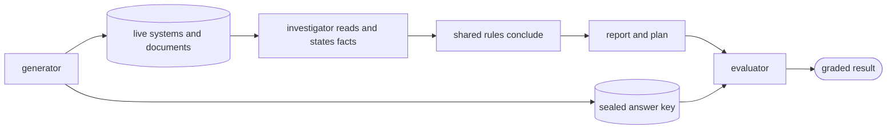
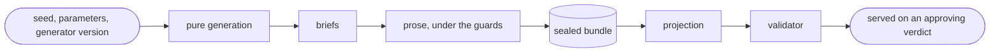
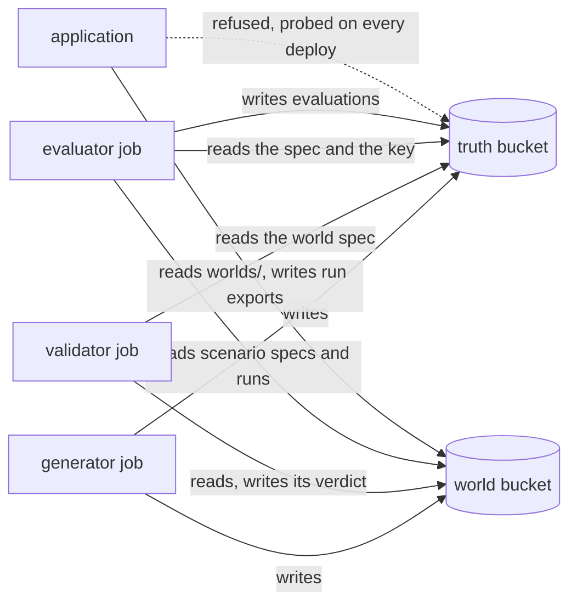
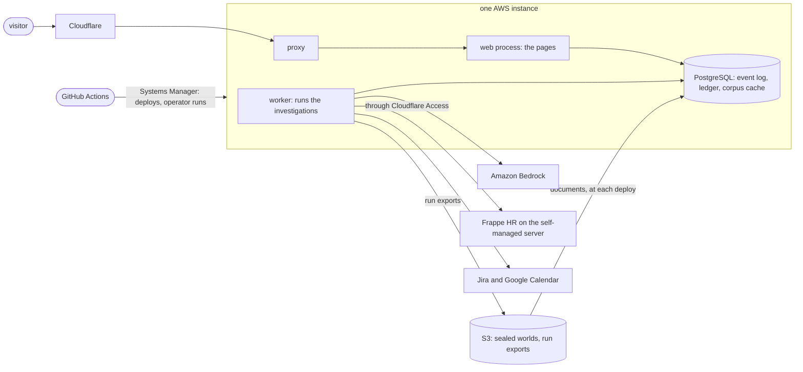

# DESIGN — leave-impact-agent

What was decided and why. Each section states its decisions with the reasoning, the
alternative that lost and the limits that bound what the project may claim. How it is
built is [ARCHITECTURE](ARCHITECTURE.md)'s job, and the complete dated record of every
decision is [DESIGN_RECORD](DESIGN_RECORD.md). Each decision here keeps the name it has
in the record, and each section ends with a collapsed list of the decisions it leaves to
the record.

*Snapshot at the demo milestone's close · last updated 2026-11-10.*

## The design in one page

An agent's answer about a leave can only be graded if the right answer is known, so the
organization is generated together with its answer key and the key is sealed where the
agent cannot reach it. The model never concludes: it reports facts with the text they
came from, and deterministic rules draw every conclusion, which is also what makes the
grading exact. The measurement was registered before its data existed. The deployed
system serves its own records, and every run's spend is reserved before it is made.



| Decision | What was chosen | What lost, and why | Section |
|---|---|---|---|
| Grading | one typed vocabulary of six claim types, graded deterministically | an LLM judge on rationale text: no hand-graded set exists and calibration is its own measurement problem | [What a valid answer is](#what-a-valid-answer-is) |
| The organization | one company of 28 people shared by all thirty scenarios | an organization per scenario: it removes exactly the irrelevant-but-plausible evidence the evaluation exists to test | [One organization, many scenarios](#one-organization-many-scenarios) |
| Model-written prose | accepted only when it carries every required fact and none its brief does not allow, under three automated guards, one a second model family | a lexicon check: "led the Kafka migration" and "has never worked with Kafka" pass the same vocabulary test | [Truth before prose](#truth-before-prose) |
| Failed generations | discarded and retried, never patched | patching: a patched artifact's provenance is model output plus a fix plus perhaps a human edit | [Truth before prose](#truth-before-prose) |
| The answer key | in a bucket the application's role has no capability over, probed on every deploy | a generator role the instance could assume: a role the instance may assume is a role the application can obtain | [Sealing and the audit](#sealing-and-the-audit) |
| The model's job | it states quoted facts, and shared rules conclude | the model writing the report: it was wrong in some row of every scenario tried | [Keeping the benchmark out of the product](#keeping-the-benchmark-out-of-the-product) |
| The tool surface | typed tools generated from read ports by a role-scoped registry | MCP: one in-process consumer of a small owned read surface gains nothing from a protocol | [Keeping the benchmark out of the product](#keeping-the-benchmark-out-of-the-product) |
| The measurement | a committed registration, frozen before the measurement world existed, with one primary comparison | reading a tier or a secondary comparison as a win: no claim of success is made from them | [Keeping the benchmark out of the product](#keeping-the-benchmark-out-of-the-product) |
| The agent loop | LangGraph inside the agent package, the event log as the authority and the checkpoint a cursor | a hand-rolled loop, which was the lean | [The deployment](#the-deployment-the-evidence-is-served-from) |
| Recovery | from the log, on a fresh checkpoint thread per generation, accepted by a crash matrix | a shared checkpoint thread: a checkpoint also holds pending task writes the framework uses to skip tasks | [The deployment](#the-deployment-the-evidence-is-served-from) |
| Hosting | the application on AWS, Frappe HR on the self-managed server | everything on one side: no cloud evidence, or paying to host the simulation for no product reason | [The deployment](#the-deployment-the-evidence-is-served-from) |

---

## Objective

An agent that investigates what an employee's leave means operationally, reading the
HRMS, the issue tracker and the calendar through their real APIs, and a document
corpus, and drafts an evidence-backed coverage plan for a human to approve. Deterministic rules own the normal
path; the agent investigates exceptions; the human decides, and the agent never does.
The organization is generated into real systems by a generator that also emits the
sealed answer key, so every claim the agent makes can be graded against constructed
truth.

### The success criterion

A valid answer is a report whose facts trace to org data, whose plan satisfies the
scenario's planted constraints, and whose unknowns are stated rather than invented. It
is measured across an evaluation spine by difficulty tier, and served from a deployment
that exists from the first milestone on.

### Probes preceded the remaining design

The fatal unknowns (Frappe standing at its real footprint, Frappe's REST surface, Jira,
Google Calendar, the generator's seed spike) and the two deployment floors (the instance
under Terraform, the OIDC deploy) were probed before anything was designed on them, each
pass criterion fixed before its probe ran and recorded in `probes/README.md`, each
outcome in `probes/FINDINGS.md` with captures beside it.

The framework, tool-layer and post-approval questions were deliberately not decided
before that evidence existed.

---

## What a valid answer is

*In brief.* The agent's report and the answer key are written in one typed vocabulary of
six claim types, so grading compares typed facts and scores no prose. The vocabulary
keeps "nobody can cover this" apart from "I could not find out", which stops the
benchmark from rewarding caution. A negative is concluded only where every structured
place the fact could live was actually read; the document corpus, read by search, is
the stated exception.

### The report and the key speak one typed vocabulary, frozen at the world milestone

Everything downstream grades on it and the generator emits truth in the same words, so
the types, their grading keys and the four semantic rules below are lasting; field names
and enum members can still grow. Six claim types:

```text
impact                key (leave_id, subtype, artifact)   subtype: deadline | meeting | responsibility
constraint            key (clause_id, applies_to)
candidate_assessment  key (impact_key, employee_id)       verdict: viable | non_viable | unknown, reasons[]
source_conflict       key (entity, predicate)             observations[], resolved_value, authority_rule
unknown               key (subject, required_fact)        reason: absent | inaccessible | ambiguous | conflicting | insufficient
coverage_action       key (impact_key)                    action: assign | uncovered | unknown, assignee_ids[], rationale?
```

Impacts describe what the leave affects; constraints what a valid response must obey;
candidate assessments who could satisfy a need; coverage actions what the proposed plan
does; conflicts and unknowns where the evidence chain could not be established.

Every type has its own grading identity because a universal `(type, entity_id)` fails as
soon as a claim is relational: an assessment is a person *for* a need, a conflict is an
entity *and* a predicate. Evidence refs are plural from the first schema: a single
non-viability can rest on Calendar, Frappe and a clause at once, and a single-source
field would tempt the agent to cite one fragment of a multi-source inference.

Not added, deliberately: `violation` (the constraint checker emits those), `evidence`
(that is provenance), `risk` (an impact already is one), `reasoning` (report layer, not
benchmark ontology).

### Grading identity is computed from a claim's fields, never from a claim id

Claim ids are minted by whichever emitter wrote the report, so the same world fact
carries different ids in the agent's report and in the answer key; the grading key
identifies the fact across emitters, while `derived_from_claim_ids` links claims inside
one report.

### Absence is a record of its own

A `Gap` says the record was observed and this field held no value, and never a failed
read: a failed read is the run condition, passed beside the run's context, because one
scenario runs under several. Conflating the three (a gap, a failed read, zero facts)
would break the derivation of closure. A ticket without a due date is an observed
negative, not a gap.

### Closure answers in a fixed order and derives three of the five unknown reasons

It reads the facts and gaps a view holds at `now` and asks the view what it observed. A
positive fact is known true. Otherwise each place the answer could live is a *slice* of
a source, and the view says of each whether it was observed whole:

| What the view says of a slice | The rule's answer |
|---|---|
| its source could not be read | unknown / inaccessible |
| nobody read it | unknown / insufficient |
| the record was read and the field is a gap | unknown / absent |
| the domain is open | unknown / insufficient |
| otherwise | known false |

Zero facts mean false only after every slice the answer could live in has been observed,
and a gap blocks that inference.

For a run, observed and reachable come apart: a source can answer every call and the one
record that would settle a question never be asked for, and an unread record is not a
negative. Read by reachability alone, a run that read nothing would have every "not on
leave" and every "lacks the skill" confirmed by its own silence.

`ambiguous` and `conflicting` are the agent's to emit, never the rule's, which keeps the
rule's derivation and the agent's own uncertainty apart.

> **Limit.** One slice no read closes for the rules: the corpus's documents, which the
> investigator reads by search. A negative may stand without it and says that it did,
> because a negative that waited for it would be out of reach for every system that
> searches.

### Four semantic rules travel with the vocabulary

| Rule | What it fixes |
|---|---|
| Viability is relational and preference is never truth | the key states whether `(need, employee)` is viable and why; "the best person" has no exact truth unless an optimization rule is declared, and none is |
| Extra candidates are judged from the truth fact base, never from re-reading the world | the scenario plants a bounded `must_assess` set with authored verdicts, and any further candidate the agent proposes is recomputed by the evaluator's pure viability rule over evaluator-only normalized facts |
| Conflicting observations resolve through a deterministic authority table | each normalized predicate has exactly one system of record, and the conflict claim cites the rule id so precedence is testable instead of intuited |
| Closed-world reasoning applies per declared evidence domain | each predicate declares the sources that collectively hold all admissible evidence for it in this synthetic world and whether that domain is closed |

The evaluator and the deterministic core share those pure rules, which is not the
generator-echo problem but does admit a shared rule bug. The generator invariant that
closes it: for every `must_assess` candidate the authored verdict must equal the rule's
verdict over the fact base, and a mismatch fails scenario generation rather than grading
an agent wrong.

Expected verdicts are derived per run condition from facts plus closure declarations
rather than stored: a tool-failure run against the same scenario legitimately turns a
`non_viable` into an `unknown`, and that difference is the tool-failure metric.

### Three coverage outcomes, and the unknowns chain

`assign` is a positive conclusion, `uncovered` a negative one (the evidence suffices and
nobody qualifies), `unknown` an epistemic limit. Keeping the second apart from the third
is what stops the benchmark rewarding caution: "I don't know whether anyone can cover
this" against a complete world that establishes nobody can is wrong, and so is "nobody
can" when a required source was unreachable.

The word `unknown` appears at three levels with one relation between them. Missing
evidence → unknown fact → unknown assessment → unknown coverage, one chain, not three
unrelated uses of a word.

### Grading falls out of the vocabulary, and no prose is scored

For impacts and constraints the key is the whole fact. For every other type the key
names the subject and the payload states the claim, so key match and payload
correctness are reported apart and a matched key with a wrong payload is never a true
positive.

Grounding: the pure rules are run over everything the run observed with the report's own
claims as premises, and a claim is reproduced when they conclude its payload,
contradicted when they conclude another, and unsupported, with a typed reason, when they
cannot conclude from what was read. Whether the cited references resolve is a separate
count, so a broken citation and an unsupported inference are different numbers.

The first draft sent the rationale text behind an action to an LLM judge calibrated on a
hand-graded set. It was superseded, since the rationale is optional in the vocabulary, no
hand-graded set exists, calibration is its own measurement problem, and the claim this
benchmark makes rests on deterministic grading against constructed truth. It returns as
future work when rationale quality has a consumer.

The ontology is frozen whole and exercised gradually: the first golden set covers the
types its scenario classes need, and no scenario is authored to give a type coverage.

<details>
<summary>Also decided in this section, in the record</summary>

- [A constraint's rule is its clause](DESIGN_RECORD.md#a-constraints-rule-is-its-clause)
- [Serialization is a stdlib codec in one module](DESIGN_RECORD.md#serialization-is-a-stdlib-codec-in-one-module)
- [The fact base is the rules' only world](DESIGN_RECORD.md#the-fact-base-is-the-rules-only-world)
- [Viability evaluates four criteria through closure and combines them](DESIGN_RECORD.md#viability-evaluates-four-criteria-through-closure-and-combines-them)
- [Criteria assess a candidate; the count judges the plan](DESIGN_RECORD.md#criteria-assess-a-candidate-the-count-judges-the-plan)

</details>

---

## One organization, many scenarios

*In brief.* One synthetic company holds all thirty scenarios, so the people, tickets and
policies of other teams are the plausible wrong answers a search has to reject. Time is
part of the world: a run is given its date and never reads the clock. The set is sized
to localize failures, not to rank models.

### One generated organization, read-shared, write-isolated, truth-isolated

The org is a single synthetic company of roughly 25 to 30 people in about five teams.
The agent sees the whole org: other teams' people, tickets, meetings and policies are
the plausible-wrong candidates that make coverage a real search, which a six-person
sandbox cannot produce.

Scenarios are slices of that org, not orgs of their own: each owns its mutable entities
(the leave, its tickets, its events) and a time window, never writes into another
scenario's entities, and carries its own sealed answer key, which the validator
re-derives against the full live org so cross-scenario contamination is caught rather
than assumed away.

Org-per-scenario was rejected: it simplifies ground truth by removing exactly the
irrelevant-but-plausible evidence the evaluation exists to test, and multiplies the seed
and validation runs for no gain.

### People are cheap and scenarios are expensive

A person is a handful of generated records per system; a scenario is planted facts,
named distractors, a relevant policy clause, a defensible key and a hand audit. The
golden set therefore grows by adding scenarios in new time windows, not by adding
employees. Three constraints keep the construction honest:

- a team does not determine its scenario's type, so structure cannot stand in for
  reasoning;
- distractors are planted and named in the key with the reason each is wrong, so a
  near-miss is gradable;
- policy clauses have real-world scope only (contractors, a country, a grade), with
  scenarios chosen so a clause becomes relevant, never clauses written to make one
  scenario's answer come out.

### Time is world state, never the machine's clock

Every run receives a `RunContext`: scenario id, world (seed) version, a canonical `now`
as an instant with a reference timezone. That is the reproducibility boundary: same
scenario, same world version, same `now` → same evidence, on any machine, months later.
No core, adapter or evaluator code reads the wall clock for world semantics, and a test
enforces it.

Telling the agent "today is 2026-10-01" is not cheating, since a deployed assistant
knows the date too; only its source is fixed.

The tool surface exposes exactly the fields the generator controls, which settles vendor
timestamps without per-field judgement: Jira's `created` is absent from
`search_work_items` because the seed cannot set it, and becomes a world fact the moment
it can.

### History is planted only where it can be planted honestly; qualification is derived from atomic facts, never stored as a conclusion

Jira's REST API cannot set `created`, `updated` or `resolutiondate`, so "Bob resolved
twelve payments tickets last year" is not a plantable world fact over REST.

Coverage qualification is therefore expressed as atomic, world-observable facts spread
across the systems (an employee's skills on the Frappe record, a Jira component with its
named synthetic members, a policy clause stating what coverage requires, the calendar's
free/busy, the active tickets a person owns), and the agent derives "Bob is a valid
candidate" from them; no system stores that conclusion, which is the same rule that
keeps decisions out of tools.

Date-level history ("opened in March, resolved in May") is plantable without a manual
step; actor-level history ("who handled this before") remains outside the first truth
model.

### Thirty scenarios, ten per tier; a tier is a capability level, a class is what a scenario is about, and modifiers ride on top

The tiers name how far the reasoning has to reach.

| Tier | Where the answer lives | What it tests |
|---|---|---|
| 1, structured | every answer-relevant fact sits in a structured field | tool use, temporal filtering, joins across systems and the deterministic candidate check |
| 2, fragmented | at least one answer-changing fact needs synthesis beyond structured fields (a qualification that exists only in a ticket comment, a responsibility that exists only in a runbook), and/or the single supported clause type, "a release needs two qualified engineers" | reading what the fields do not say, and a clause that turns a one-person answer into two |
| 3, adversarial | the correct output depends on reasoning about the evidence itself | a stale runbook against Jira, a genuinely missing fact, or a complete world in which nobody qualifies |

Underneath the tiers, scenario classes give results a second reporting axis, so a tier
that scores badly decomposes into which mechanism broke. Distractors and candidate
pressure are orthogonal modifiers tagged on a scenario, never classes of their own.

Tool failure is a run condition applied over any scenario, never a scenario class, so
degradation is measured against an unchanged key. Five conditions are registered: the
normal one, and the tracker, the calendar, the HR system or the corpus unreachable.

### Primitive failure modes repeat independently before any composite

Three unknown-outcome cases and three uncovered cases are worth more than six in which
both occur, because the distinction the vocabulary encodes is only measurable when the
cases are separate.

The set is sized for engineering evaluation and failure localization, not fine-grained
model ranking: at ten scenarios per tier a score of eight in ten carries a Wilson
interval near 49 to 94 %, so two tiers a few points apart are not distinguishable, while
the failure classes behind them are. Uncertainty is reported at scenario level,
bootstrapped over scenarios.

The set grows after the first evaluator shows which classes need more cover, not before,
and not to narrow an error bar.

<details>
<summary>Also decided in this section, in the record</summary>

- [Synthetic employees are domain entities, not vendor users](DESIGN_RECORD.md#synthetic-employees-are-domain-entities-not-vendor-users)
- [A scenario owns a disjoint fourteen-day slice; the leave sits inside it](DESIGN_RECORD.md#a-scenario-owns-a-disjoint-fourteen-day-slice-the-leave-sits-inside-it)
- [Org-level facts are static across the world; scenarios select, never mutate](DESIGN_RECORD.md#org-level-facts-are-static-across-the-world-scenarios-select-never-mutate)
- [The fact base is world-level and time-filtered by `now`](DESIGN_RECORD.md#the-fact-base-is-world-level-and-time-filtered-by-now)

</details>

---

## Truth before prose

*In brief.* The world's facts are generated first, deterministically, as plain data. A
model then writes only the prose that carries those facts, and a text is accepted only
under three automated guards, one of them a second model family that must find every
required fact in it and nothing its brief does not allow. For the first golden set a
person also read every answer-changing text.
A separate validator then re-reads the live systems and compares them with what was
sealed.



### Semantic generation is deterministic and pure; surface prose is materialized once and frozen; projection reads the frozen world

Seed, parameters and generator version go into the pure generator and the complete
structured world comes out as plain data, with a *brief* for every piece of prose the
world needs.

A second stage materializes the briefs into text: deterministic templates for
structured-shaped text, since nothing is learned from paying a model to write a ticket
title, an LLM for the language-bearing artifacts that free-text reasoning is meant to
exercise (runbooks, client notes, ticket comments, procedure prose). Accepted prose
joins the specification as immutable world data, and re-projection never invokes a
model.

The world version is the realized bundle's content hash, never the seed, because two
runs from one seed may differ in prose; "the same seed produces the whole world" would
have been false the moment a model wrote a sentence. A *semantic digest*, the hash of
the semantic world with its briefs, is the identity two runs from one seed share.

### A brief carries facts, never sentences, and the model does surface realization only

A brief holds the target's construction fields, the required facts as positive `Fact`
records, the allowed context facts, a surface namespace derived from those facts through
the closed vocabulary, and a register. "Must include the sentence 'Deniz has Kafka
experience'" would turn the benchmark into paraphrase detection.

A required fact's role, answer-changing or context, is derived by running the rules with
the fact removed, never tagged, because a wrong tag would misdirect the hand audit
silently.

### Generated text is accepted only under semantic containment

Every required planted fact is present and no additional benchmark-relevant fact is
introduced, `required(brief) ⊆ claims(text) ⊆ allowed(brief)`. A lexicon check is not
that guarantee: "Deniz led the Kafka migration" and "Deniz has never worked with Kafka"
pass the same vocabulary test, and "three engineers must attend" adds a cardinality
without one forbidden word.

Four guards enforce it, the paid one last:

| Guard | What it does |
|---|---|
| a namespace scanner that owns *mentions* | refuses every world name and unlisted date outside the brief's allowed set |
| a required-fact check | refuses a fact which vanished in the writing, before the checker is paid |
| an extraction check by a different model family | receives the entity dictionary and a schema but never the brief's facts, and refuses any negated, hedged, unknown-subject or unrepresentable proposition |
| a human reading, for the first golden set | of every artifact that carries an answer-changing fact |

The extraction check is a generation-time gate that never becomes truth, which stays the
structured brief.

> **Limit.** The scanner has two exceptions that match in exact spelling only: a form of
> three characters or fewer, because the skill Go would otherwise refuse most sentences,
> and team and component names, which are dictionary words by design. The first stands
> as a heuristic the first world never exercised.

### Failed generations are discarded and retried, never patched

A patched artifact has the provenance "model output plus generator fix plus perhaps a
human edit"; a discarded one needs nothing.

Each attempt is a fresh sample of one identical request with no refusal fed back, so
retry depth measures one fixed configuration's difficulty and a systematic fault (twelve
refusals of twelve) stays visible rather than hidden behind a second-attempt pass. The
default cap of eight attempts is a robustness margin rather than a measured need, and
is raised where a filler section exhausts it.

Rejected text exists nowhere, because the repository is public and its job logs are
world-readable, so a logged rejected sentence would be a third benchmark-private surface
with no access policy. Every model call precedes every external write, so a failed stage
leaves nothing behind. At thirty scenarios the whole stage costs well under a dollar per
world without filler; the final materialization of the second development world, with
its filler pool, cost $5.15.

### Constructive selection, never rejection sampling

A scenario class states what it needs from the static organization as a query and
returns every admissible construction in a canonical order; the RNG chooses among them;
the construction plants the owned entities and authors the expectations; `core`'s rules
then run over the truth base as an independent check, and a mismatch is a named
construction error, never a retry and never a reclassification.

The query is deliberately weaker than the rule, since a query that mirrored the rule in
reverse would make the invariant's independence a fiction.

Required sources are found by asking the rules under each single-source outage, never
from evidence provenance, because a negative conclusion carries no evidence fact yet
depends on every source of the predicate's domain.

### A scenario is correct locally against its key; a world is correct globally over the history observable at each scenario's `now`

A record one scenario plants can change a verdict in another slice months later, which
per-scenario verification cannot see, so the golden set is valid only after every
scenario is re-verified against the assembled world.

Contamination is a construction error naming the scenario, the changed verdict and the
foreign record, never a repair or a redraw, since a world that needs re-draws is a class
whose affordance is under-specified.

### Three sealed artifacts serve three readers, and storage follows access

| Artifact | Holds | Who reads it |
|---|---|---|
| the world spec | organization, plan, slices, provenance, the other files' hashes | benchmark-private: the validator and the evaluator |
| the scenario specs | the agent-visible rows | the application, and the evaluator |
| the truth manifest | the answer keys | the evaluator only |
| the world manifest, a fourth and different object | the projection's receipt: adapter configuration, the identity map from semantic to vendor ids | the application; it holds no fact that can change an answer |

The world spec is benchmark-private, since the plan alone names which traps were
planted. A first cut had put the plan in the application-readable file; the identity-map
write-back alone proves the two cannot be one.

### The sealing order keeps a half-finished run harmless

The two truth objects go first, by conditional create, before the first vendor call, so
live vendor state never exists without its sealed answer key, while truth-only orphans
are harmless because nothing serves without a manifest. The manifest goes last, so an
object under `worlds/` with a manifest beside it is a completed projection by
construction.

A world is served only on a verdict that judged its current manifest, never "whatever
verdict file exists". The verdict must judge under the current validator version, since
an older logic approved a shorter list of checks and a world judged under one is
validated again.

### The validator is a distinct module that only reads, and validates the projected systems rather than the generator's intermediate objects

It re-reads the live systems the way the investigator reads them and compares them with
the sealed spec: every closed enumeration exact, missing and foreign both named; every
record equal to its planting; a check that could not run saying so and never counting as
passed.

Validating the projected systems puts the projection seam under test, so a shared
generation bug cannot produce an evaluation that agrees with a wrong world.

> **Limit.** The chain is complete for the structured tier; prose-carried facts are
> proven through the containment gates and the corpus's read fidelity.

<details>
<summary>Also decided in this section, in the record</summary>

- [Filler is a world-level pool, and a level is a count into it](DESIGN_RECORD.md#filler-is-a-world-level-pool-and-a-level-is-a-count-into-it)
- [Materialization's provenance seals in the truth manifest](DESIGN_RECORD.md#materializations-provenance-seals-in-the-truth-manifest)
- [Before sealing a restart regenerates; after sealing it resumes the named realization](DESIGN_RECORD.md#before-sealing-a-restart-regenerates-after-sealing-it-resumes-the-named-realization)
- [An organization is identified by three inputs and guarantees shapes, never coverage](DESIGN_RECORD.md#an-organization-is-identified-by-three-inputs-and-guarantees-shapes-never-coverage)
- [The world plan is data, drawn by a planner that never decides whether a plan exists](DESIGN_RECORD.md#the-world-plan-is-data-drawn-by-a-planner-that-never-decides-whether-a-plan-exists)
- [The timezone affordance is guaranteed by the organization, and the far seat is always a colleague](DESIGN_RECORD.md#the-timezone-affordance-is-guaranteed-by-the-organization-and-the-far-seat-is-always-a-colleague)
- [Projection is the effectful, idempotent shell](DESIGN_RECORD.md#projection-is-the-effectful-idempotent-shell)

</details>

---

## The classes that leave the easy path

*In brief.* Beyond the structured tier, each scenario class puts the answer somewhere a
field does not hold it: a comment, a document, a clause, a conflict between sources, a
fact that is missing. Each class was built by asking what the rules would conclude about
the scenario it plants, and several of its rules came from a count that overturned a
guess.

The classes beyond the structured tier (a qualification in a comment, a responsibility
in a document, the cardinality clause, the conflict, the missing fact, the complete
world nobody covers, and the two composites) rest on rulings that mostly extend `core`
before any class exists, each found by asking what the rules would conclude about a
scenario the class plants.

### A responsibility that exists only in a document is a fact of its own

A row of the predicate registry, `names_responsible`, has the section as its subject, the employee as its
value and the corpus as its sole evidence. The impact's artifact is the section itself,
so the section is both the obligation and its provenance.

The alternative primitive, a runbook giving an owner to a ticket the tracker shows
unassigned, was rejected: it attributes a known ticket rather than discovering an
obligation with no structured trace, and it blurs into the conflict class.

Whether the investigator's retrieval surfaces a section is an evidence-coverage
measurement of the agent, not a world invariant, so the validator runs no query against
the live corpus.

### Impact grounding is a conclusion

Impacts were authored and never derived, so a fact whose only role is to make an impact
exist was invisible to the role derivation by ablation and the required-sources
derivation by outage: harmless while every impact rested on planted records, fatal for a
class whose one prose fact is the impact's ground.

A grounding rule asks, per exact impact key, whether the leaver holds the obligation,
and the enumerator over the leaver's facts applies the same predicate, so discovery and
grounding cannot drift apart.

### Missing information and uncovered differ in one placement

Both plant the same deadline shape under a clause requiring the unheld skill, so every
recorded employee fails by skill and a blank-record employee is unknown only when every
other criterion passes.

The missing-information class puts its release in a component holding a blank-record
member, and the outcome is unknown; the uncovered class puts it in a component holding
none, so the blank-record people fail by component, and the outcome is uncovered. Under
a tracker outage both become unknown by inaccessibility, the run-condition metric's own
axis.

### The stale conflict sits on a real impact, and reads resolve

The tracker says the leaver owns the release ticket; a model-written runbook section
names a teammate outside the component as owner. The impact stands, grounded on the
tracker; the failure caught is an agent that believes the document, drops the impact or
hands cover to the named owner, which the component rule makes a graded error.

Two gaps in `core` surfaced. Closure did not apply authority, so a positive fact with
the asked value was known true from any source. And conflicts were not conclusions, so
the stale-owner fact would have been labeled context and skipped at the hand pass;
derived conflicts now enter the conclusions.

### The world records what each admitted scenario binds, and refuses a later candidate that crosses it

The first plan seating the responsibility class beside other rows was refused by the
whole-world re-verification on twenty of twenty seeds, on interactions no per-scenario
test can see: a person one scenario's note names responsible being another's leaver, and
a person one scenario's prose gives a skill being another's candidate authored
non-viable by it.

The reservation book records, in construction terms and never class names, the leave
subjects, the standing contacts, the (person, skill) pairs provided in prose and the
pairs an authored verdict assumes absent, and refuses a crossing in both directions, so
construction order never decides correctness. A retry on collision was rejected as
rejection sampling at world level; the re-verification stays the oracle for interactions
the book does not know.

Rows are constructed in a seeded random order and the windows are dealt by a seeded
permutation. On twenty seeds the window's start predicted the tier on every one under
the forward dealing, and under the scarcity order the ids a model sees predicted it at
0.69 to 0.92 by kind. The permutation and the shuffle bring every kind within 0.05 of a
random order's own column, except ticket comments, which one class alone plants, so a
comment's presence names the tier under any order. The cost is feasibility: the random order exhausts four of two
hundred against the scarcity order's one. A refused seed is a loud refusal naming the
row and the rules, and the contract promises no world for every seed.

### The materialization gates were tuned on one measurement world, then frozen

The world this heading names was built to measure the prose gates. It is not the
secret-seed measurement world the result was later measured on.

One world under the real pipeline, sealed and validated and never counted among the
thirty, gave the numbers the design had predicted and never measured: first-attempt pass
two of three, eventual pass three of three, no cap exhausted, about a cent and a half
for the run, and a hand sample of three with every required fact read correctly, a
sample that supports no rate.

No second measured world: later registers were probed on unsealed passes with human
inspection, no rate reported, the accepted risk being that a defect found only at the
golden audit costs a new golden realization.

### Each register is fixed on a probe, and the checker keeps its model

The section probe fixed two checker-prompt facts; zero of six constructions were
accepted before them, six of six after. A checker-side sentence against inferring
membership was probed in two placements, read identically under both, and was dropped;
the register change is what the record credits. The component clause was obeyed in
about half the texts and recorded as measured, and no exhaustion probability is
estimated from fourteen attempts over three unlike briefs.

Nova Pro stays the checker over Haiku 4.5, whose stricter reading filed the writer's own
experience claims as other claims; the pair's different families are part of the
independence claim. The disagreement is the finding, that the automated gate is limited
by the checker's proposition recall, which is why the first set's coverage is three
layers together, the lexical guards, the extraction containment and the human acceptance
of every answer-changing text.

<details>
<summary>Also decided in this section, in the record</summary>

- [A section-artifact impact narrows its candidates by a clause](DESIGN_RECORD.md#a-section-artifact-impact-narrows-its-candidates-by-a-clause)
- [Constraint-bearing documents are scenario-owned](DESIGN_RECORD.md#constraint-bearing-documents-are-scenario-owned)
- [A policy scopes itself by the release's exact title, and titles are minted without replacement](DESIGN_RECORD.md#a-policy-scopes-itself-by-the-releases-exact-title-and-titles-are-minted-without-replacement)
- [The cardinality class carries both consequences in every row, and the organization seats its cast](DESIGN_RECORD.md#the-cardinality-class-carries-both-consequences-in-every-row-and-the-organization-seats-its-cast)
- [Concurrent leave is coverage-aware, over the record and not the authored verdicts](DESIGN_RECORD.md#concurrent-leave-is-coverage-aware-over-the-record-and-not-the-authored-verdicts)
- [The key seals two derived conclusions, the conflicts and the unknowns](DESIGN_RECORD.md#the-key-seals-two-derived-conclusions-the-conflicts-and-the-unknowns)
- [Composites are fixed pairings whose constituents stay independently observable](DESIGN_RECORD.md#composites-are-fixed-pairings-whose-constituents-stay-independently-observable)
- [The tiered plan is one table per tier, each checked on its own slice](DESIGN_RECORD.md#the-tiered-plan-is-one-table-per-tier-each-checked-on-its-own-slice)
- [Required-source derivation is semantic, not provenance-based, and its one untested half is a documented claim with a re-arm list](DESIGN_RECORD.md#required-source-derivation-is-semantic-not-provenance-based-and-its-one-untested-half-is-a-documented-claim-with-a-re-arm-list)

</details>

---

## Sealing and the audit

*In brief.* The answer key is kept from the application by AWS permissions, and a probe
proves it on every deploy. The world is generated and checked by jobs the application
cannot become. A world is called golden only after a person has read every scenario and
traced a stratified part of them in full.



### Benchmark state is split by audience and authority, and "sealed" is enforced, not promised

World and truth live in separate S3 buckets; the application's instance role can read
the world bucket's `worlds/` prefix and has no capability over truth at all, not a
read, not an assume.

The evidence a reader can check is taken on the host itself, on every deploy, under the
real instance profile: a list of `worlds/` succeeding as the positive control, then a
list of the truth bucket and a get of a key known to exist there, both refused with the
`AccessDenied` code specifically. Anything else turns the deploy red with no rollback,
since a broken boundary is the platform's fault and not an image's.

The key must exist because S3 answers a get of an absent key with `AccessDenied`
whenever list is denied, whatever the get permission says. The first probes proved only
the list denial that way, and a platform-owned canary object closed the gap.

### The generator is never part of the deployed runtime and never runs from the instance

It knows both halves of the split. An earlier design had it assume a generator role
from the instance profile through STS, and that was a process distinction, not an IAM
one: a role the instance role may assume is a role the application can obtain, so the
boundary was a promise.

The generator and the validator are instead dispatched jobs under one GitHub
environment, reviewer-gated and `main`-only, separate from the production environment
the deploy job uses so the deploy job cannot write truth. Each job assumes its own
OIDC-trusted role, with no long-lived AWS secret anywhere.

The split lives in the two roles' policies, not in a second environment, which would
guard against the project's own committed workflow code at the cost of duplicating the
vendor secrets. Binding each role to its workflow file through the token's
`job_workflow_ref` claim is the later hardening.

The validator and the investigator each hold their own read principals:

| Vendor | What makes a reader read-only | Limit |
|---|---|---|
| Frappe HR | a user on a read-only role over the four doctypes a reader touches | none recorded |
| Jira | an API token that carries the read scope alone | the account keeps write permissions the token cannot exercise |
| Google Calendar | the code | no read-only scope exists over app-created calendars |

For Frappe and Jira read-only rests on the credential and not only on the read ports
and the import law. Calendar is the recorded exception: the one read-only scope that
exists is sensitive because it reaches the owner's personal calendar, so both readers
hold the generator's grant, bounded to the calendars the app made. Each principal was
accepted by a live probe: reads equal to the writer's field by field, a known-valid
write refused, and for Calendar the reach bound measured (`probes/FINDINGS.md`, the
read-principals entries).

> **Limit.** The instance's Calendar credential can create, change and delete events on
> the synthetic calendars; re-validation against the sealed manifest detects such drift
> afterwards, prevents none of it, and recovery is a regeneration. A claim of read-only
> vendor credentials everywhere is therefore not available until a dedicated reader
> account lands.

### Integrity is the guarantee underneath secrecy

Every final object is written once, by a conditional create the bucket policy enforces
on the final prefixes: a plain put refused, a second create refused, and a refusal
accepted only when the bytes already there are the bytes being sealed. Objects are
versioned with no delete grant to any job.

Every evaluation run records world version, scenario id, truth digest and version id,
harness commit and model before grading, so a result months later is the same
question about the same world against the same key.

Held-out truth and its audit notes stay in the truth bucket, never in the public
repository; the repository publishes the audit methodology and fully released example
scenarios, and a retired evaluation set can be published whole.

The golden world was released that way with the demo, its scenario specs and keys
included, under `docs/golden-world/`. Nothing of the measurement world is public until
the last measurement on it.

### Two audit depths make "golden" an honest word

Every scenario receives deterministic validation and a human acceptance pass, so every
scenario in the set has been looked at. Ten of them, stratified across the tiers,
receive the full trace: every expected claim followed back through its evidence, the
candidate facts, the distractors, the authority resolution and the coverage outcome.

Thirty scenarios inspected only ten deep would be a generated evaluation set with an
audited subset, and would be named that. The protocol is
[AUDIT_METHODOLOGY](AUDIT_METHODOLOGY.md), published scenario-free.

### The audit is written once under a content-addressed identity

The identity is the digest of the audit's index, content-addressed and never ordinal,
so a corrected audit is a new identity beside the old with the old named in the index's
`supersedes` field, never a rewrite.

Overwrite is refused by policy for every principal. Delete is held by convention and
versioning rather than policy, and the only writer is a human under the administrator
identity from a workstation.

### A scenario released as an example is retired first

It keeps its place in the sealed world and in the audit's provenance, it leaves the
scored set of every later blinded evaluation, and the release carries a contamination
statement.

No golden scenario is released before the first evaluation has run over the whole set,
since the example a reader values is the key beside an agent's run on it, and
retirement before any evaluation would be a promise with nothing to enforce it.

This rule was written for single examples. The golden world's release, whole and with
its keys, was ruled separately on 2026-10-19 (the integrity decision above).

> **Outcome.** The first golden world is sealed, and its audit is sealed under its
> content-addressed identity. The hand audit executed the acceptance pass over all
> thirty scenarios and seventeen deep traces: ten stratified, five by unexercised
> structure, two named by a critique panel. Findings: thirty accept, no defect in the
> world, no open question; the audit's own record corrected in eleven places with dated
> notes, none touching a key.
>
> What the audit cannot claim: it verifies the key against the rules as coded and a
> human reading of the evidence, the recount sharing the rule's dated view; every
> accepted qualification comment opens on one sentence frame ("I have X experience"),
> a realism limitation not tuned; thirteen scenarios rest on the pass, the executed
> checks and the recount rather than a trace; the reads were an external low-context
> reader's, re-verified before entry, and the rulings the auditor's. The full narrative
> is in [REPORT_NOTES](REPORT_NOTES.md).

The record holds each of these decisions with its mechanism:
[DESIGN_RECORD, "Sealing and the audit"](DESIGN_RECORD.md#sealing-and-the-audit).

---

## Keeping the benchmark out of the product

*In brief.* The investigator is a product that must not be able to see how it is graded.
It reads the world only through typed read ports, its model only states quoted facts,
and shared pure rules draw the conclusions. The evaluator is a separate job that grades
a recorded run and never touches a vendor. What is measured, and how the result is read,
was fixed in a committed registration before the measurement world existed.

### Three layers, and adapters that translate but never launder

The synthetic world exists independently of any vendor; each external system holds a
representation of it; the agent sees a domain-shaped tool surface
(`search_work_items(employee_id=…)`, `search_policy(…)`) and never a vendor's identity
system or query syntax, because the question is whether an agent can gather evidence
across organizational systems, not whether it knows JQL.

The adapters stay thin: every world fact passes through as the system reports it,
contradictions included, since an adapter that normalized a planted inconsistency away
would destroy the evidence the evaluation grades.

### A tool is one typed specification over one read-port method, constructed by a declared registry; MCP was weighed and not chosen

Each tool is a specification naming exactly one port method; the model schema is
generated from it, and a tool makes no domain decision. The registry declares per role
which methods become tools, so a tool list is constructed and never prompted. No tool
takes a date: the wrapper stamps every observation with the run's `now`, so a wrong-time
call cannot be expressed.

Least privilege is the registry and a role-scoped read-only vendor principal together.
For Calendar the principal bounds reach, not verbs, and the registry carries the
read-only claim alone.

MCP was the alternative transport: what a protocol buys is interoperability and
discovery across a boundary the project does not control, and the investigator milestone
has one in-process consumer of a small owned read surface, so a server would add a
process, a transport, an adapter dependency and a second copy of the schema while hiding
nothing.

It is reopened by an independently deployed or external client that needs a shared
protocol. The registry is what a server would wrap, so the cost then is the transport,
not a redesign.

### Ranks give the default dependency direction; denied edges enforce the trust boundaries

A rank law alone would have let the investigator import the fact base, the keys and the
briefs at source level while credentials kept it from the truth bucket at run time, a
boundary the whole answer-key design depends on, left to convention.

So `agent` never imports the benchmark or its judges and `app` never a benchmark
package; `core` never imports `world`, since the production investigator depends on the
domain without depending on the benchmark that grades it. The rank table, and which of
these rules a test holds, are [ARCHITECTURE](ARCHITECTURE.md)'s.

### The pure rules live in `core`, shared by the evaluator and the investigator

Sharing them there makes the sharing visible where duplication would hide it. Sharing
rules is not the generator-echo problem; the edges that would be are `evaluator → agent`
and its reverse, both denied. Two independent sources check the shared implementation:
the `must_assess` verdicts, authored independently of the rule, and hand-written rule
cases.

### A port returns observed entities, never facts

`core` derives facts and gaps from an observed entity in one deterministic derivation,
so an adapter never decides what is true, and the investigator's live reads and the
world's truth base agree on what every field means by construction.

A port reports three outcomes three ways, because closure treats them differently:

| What happened | What the port does |
|---|---|
| a record that is not there | returns `None` or empty |
| a source that cannot answer | raises `SourceUnreachable`, an epistemic limit the run condition records |
| a record that cannot be translated | raises `MalformedRecord`, a defect and never an unknown |

Reading and writing are two modules, so read-only is a property of the module graph.
None of this is a sandbox: the law makes an accidental violation fail CI, and IAM
remains the runtime boundary.

### The model states facts and the shared rules conclude, for every model system

A model decides what to read and states what free text asserts, each fact with its
carrier (a ticket comment or a document section) and a verbatim quote; the rules compose
every claim from the structured reads and the stated facts, and no model writes a
verdict.

A model asked to write the whole report was wrong in some row of every scenario tried,
and the same model stating quoted facts reached the rules' ceiling (`REPORT_NOTES.md`,
the one-day probe of 2026-10-04, a development result on a throwaway world).

Only a positive assertion is stated, since the rules derive a negative from a closed
evidence domain and a stated one would be a second, unverifiable route to it. A fact is
admitted when its carrier was returned by a read of the run, its quote is an exact
substring of the carrier, its subject is an entity the run read, and the quote names the
person and the skill the fact is about; anything else is refused with a reason and the
run goes on.

> **Limit.** These gates establish where a statement came from. They do not show that
> the text entails it: a negated sentence carries the same names.

### A statement is admitted over the reads logged before it, by five gates asked in one order

The carrier is inside a record a read of the run returned; the quote is an exact
substring of the carrier as read, with no normalization; the subject is a record the run
returned; the value has a form the run can look for; and the quote holds the anchors the
table asks of that predicate. The first that fails refuses the statement under its
reason, so one statement is counted once.

The decision is made over the reads logged before the answer: a later read never rescues
a refusal, and the evaluator can rerun any admission from the export.

### The evaluator runs as a dispatched workflow under its own identity, grades what the recorded run observed, and never re-reads a vendor

Its role is trusted only to a GitHub environment that holds no secrets, so a vendor
credential cannot reach the job even if a reference is added later, and the boundary is
IAM rather than a workflow review. Evaluations live with the truth, since an object
naming which claims matched the key reveals the key. An export is complete enough to
replay the grading.

The validator re-reads the live systems and the evaluator does not: that is the
difference between them. The evaluator on the instance under a second principal was
rejected, two principals on one host being two configurations and not a boundary;
workstation runs were rejected because evaluation repeats and needs run-and-attempt
provenance.

### The evaluator's oracle is runtime truth: what a run can obtain at its run day

A world has two views. The dated view admits a fact from the day its provenance became
observable; the runtime view holds every record the systems hold, dated to the run day,
which is what the harness gives a run.

Measured on forty seeds of the golden world's plan, under the normal condition none of
2,880 must-assess pairs and none of 1,280 outcomes differ, while 36 of 32,960 other
candidate pairs do, 20 of them non-viable for skill by date and viable at run time, each
because a later scenario plants evidence of the skill. Under the dated view a report
that read the later comment correctly would be graded wrong. So the oracle is the
runtime view, and planting dates do not gate it.

On the golden world no part of the answer differs under the normal condition or under a
tracker or a calendar outage, so no reported result rests on the choice, and the ruling
stands for the worlds where it does.

Under the normal condition the oracle's answer must equal the sealed key, and a
difference is raised as an evaluator defect, so the code that feeds the grader is
checked on every call and not only the rules beneath it.

### Under an outage the expected answer is derived for the condition, and two conditions have none

The registered injection fails a source for the whole run, so the condition a run ran
under is a set of unreachable sources and the oracle is runtime truth restricted to it.

Two conditions leave no claim-level answer, and the oracle says so as a state instead of
returning an empty expected set, which a silent report would match perfectly. *The
unreadable leave:* the rules take the leave's span as a premise, so when the leave's
record cannot be read nothing can be concluded. *The unreadable policy:* when the source
that holds what clauses require is unreachable, no run can establish which clause
governs an impact or whether any does.

The outages that can be graded are therefore the tracker's and the calendar's. Grading
the condition anyway was rejected as a number no system could score on.

> **Limit.** At the freeze the outage cells were cut from the registered measurement.
> The behaviour under each outage is reported as development evidence, one demonstration
> per condition on one scenario.

### Every export that decodes gets exactly one outcome, and nothing a run did raises

| Outcome | When |
|---|---|
| graded | the run completed or reported at its cap, and the oracle has an answer for its condition |
| limited | no claim-level answer exists, so no comparative answer metric is computed, and every check that needs no expected answer still runs |
| excluded | the run failed, by defect or by infrastructure, or its context is not the one the sealed scenario gives; it is counted with a typed reason |

A structurally invalid claim set is system behaviour and stays in the denominator with
zero credit. Dropping the offending claims and grading the rest was rejected, since it
needs a rule for which duplicate wins and invites gaming.

### The grounding replay gives each claim one of three standings, on premises taken from the run

*Reproduced*: the rules conclude the claim's payload from what the run read.
*Contradicted*: they conclude a different one. *Unsupported*: they cannot conclude, with
a typed reason (the leave not read, a clause not read, the candidates never enumerated).

A claim can be right and unsupported, or wrong and reproduced; the replay asks only
whether a report asserts beyond its evidence. Nothing reaches it from sealed truth
except through the view of what the run read.

> **Limit.** Once a carrier came back, grounding cannot tell reading from guessing. A
> stricter reading also refuses an answer that stood without the corpus closed; strict
> alone would make 29 % of verdicts ungroundable for every system, so one judgment is
> stored and the strict one is derived. The word grounded is never used alone for a
> result with a source left unclosed.

### Tables are cut by cell, and each kind of number has its own interval

A *scenario-level proportion*, x of n scenarios passing a yes-or-no check, carries a
Wilson interval, the scenario being the trial. A *claim-level ratio* (precision, recall,
a grounded share) is the sum of numerators over the sum of denominators across
scenarios, with a percentile bootstrap that resamples whole scenarios within their
tiers: the claims of one scenario share its people and its documents, and counting each
as an independent trial would make the interval far too narrow.

A check is read two ways. Conditional quality is over the runs the check applies to.
End-to-end success is over every run a scenario was meant to have: a limited or an
excluded run does not pass, and is counted apart from a run that was checked and failed,
so a provider fault is never scored as a wrong answer and never improves a score by
leaving.

> **Limit.** The scenarios belong to one organization and share its people, so
> resampling them says nothing about another organization. And ten scenarios per tier is
> very few clusters, where a percentile interval's coverage can be poor and visibly
> discrete; no correction is applied.

### Three baseline systems are preregistered beside the agent and graded by the same evaluator from the same export shape

| System | What it is |
|---|---|
| rules only | the frozen structured prefetch and the shared rules over it; no model call, no prose read |
| single shot | one model call, no tools, over that prefetch plus one fixed corpus retrieval whose query is written down before any run |
| full context | the same one call shown every document of the corpus level in place of a retrieval's hits |

The prefetch is one frozen rule for all four systems, a floor the agent may extend
through tools and the baselines may not, and it can use no sealed key because the
harness cannot import the benchmark.

The rules-only result on the structured tier is a plumbing check on shared rules and
never an oracle, since the baseline and the evaluator share the rules. It emits no
constraint claim, and for it grounded is not correct: the replay takes the empty
constraint list as a premise.

The comparisons measure the incremental performance, cost and latency of these specified
systems; a causal claim about the model or the tools needs a controlled arm.

### One committed preregistration file precedes the first reported run and is cited by commit in every evaluation artifact

It is one JSON file with a format version, `preregistration/registration.json`, decoded
strictly by a codec in `core` and accepted only as the bytes its encoder writes.

Names live in the file and behaviour in code: the file names the checks, the measures,
the interval method, the prefetch rule, the outage protocol and the composing policy,
and each consumer compares what it names with what its own code computes and refuses to
run on a difference, since a run that used today's value would cite a registration it
did not follow.

### The file is a draft, frozen or bound

A draft may hold a value not yet chosen, typed as pending with what resolves it. Frozen
fixes the procedure before the world it is measured on exists: it holds exactly one
pending value, the world's version, and refuses any other, any number whose basis is
unmeasured, and a world any scenario of which was tuned on. Bound holds the version and
names the commit of the frozen file it binds, and binding changes nothing else.

A change after full-set results is an amendment, the old numbers kept, further results
on the same world labeled exploratory, and confirmation needs a world from a new seed.

### The freeze registered twelve of the twenty-four cells and runs eight

Every system under the normal condition at both levels is run, 240 attempts at one
repeat, 180 of them model attempts; full context's four outage cells stay registered in
their group, decided not run with the reason in the file.

The repeat is one, a budget decision: at temperature 0 a repeat under identical digests
reproduced seven runs field for field, so the intervals describe variation across
scenarios and say nothing of run-to-run variability. That repeat was one prompt set on
the first development world, which supports that reading and nothing wider; whether it
holds on the measurement world is unmeasured.

### The freeze's values came from a calibration on the second development world

The padded level was chosen by a rule stated before the runs: of three candidate
paddings, full-context requests of about 40,000, 70,000 and 90,000 tokens, the smallest
at which full context is not correct whole (the first registered check, defined below)
on at least one calibration scenario, else the largest, never enlarged afterwards. The rule gave the first candidate: 160 filler
documents, the request measured at 42,390 to 42,642 input tokens over the six scenarios,
the base level's at 10,359 to 10,611.

At the padded levels the one-call readers fail by output saturation against the
registered 8,192 maximum, and by id discipline, document ids written where section ids
belong. A task-relevant finalization sentence probed against the
shipped one ended the saturation and restored no recall, so the shipped sentence stays
for both roles, and the report states the mechanism as such and never as evidence of an
input limit.

### A run is retried after an infrastructure failure only, and the attempt that counts is the earliest that did not fail by infrastructure

Two retries at most. A defect is not retried, because a retry could conceal it, not
because it is deterministic. The estimand is stated: the registered system with up to
two infrastructure retries. Every attempt is kept and summarized beside the counted
ones, so a failure a retry recovered from is shown and not absorbed.

An abandonment permits a new attempt exactly when the log holds no dispatch intent. That
rule is the guard against an operator choosing which attempt counts: with no intent in
the log no model output ever existed, so there was nothing to select on.

### Three checks are registered, one comparison is primary, and nothing is registered as a test of superiority

Correct whole reads the rows: structurally valid, every required row reported and right,
nothing unexpected, no plan finding against the oracle.

The primary comparison is the agent against full context on correct whole, end to end,
under the normal condition at the padded level, over all thirty scenarios. The overall
contrast is the claim; tier contrasts are breakdowns named in advance, and no claim of
success is made from a tier, an outage cell or any other comparison.

An interval that crosses zero is said to include differences in either direction, never
equivalence.

### Four supporting comparisons are declared, and nothing executes from them

Vector retrieval, a multi-agent layout, a second model and a model-authored report each
have their place, their two systems, their endpoint and their analysis in the file. At
the freeze all four were decided not built before the milestone's exit, from time and
cost. A vector arm built after the exit is exploratory on this world.

### No scenario of the measured world is tuned on

The registration declares the count in its world section and a frozen file requires it
to be zero, so the statement is in the registered bytes. Development happens on other
worlds, and a development run names its world itself.

### The mechanism measure says where a needed statement was lost on the way to a report

The statements a scenario needs are fixed by the sealed scenario and the condition a run
was assigned, never by the run. Four stages are counted over that one denominator, each
requiring the one before it, so a drop between two neighbours is a count of statements
lost at that step:

| Stage | Meaning |
|---|---|
| returned | a completed read returned a sealed carrier of the statement |
| emitted | an answer states it, from a sealed carrier that had come back before that answer |
| admitted | the record admitted such an emission |
| usable | the composed view keeps it, and for a requirement a span of it is bound to what the sealed world scopes the clause to |

A failed attempt keeps its denominator and nothing of it is usable: a system that fails
often must not show better stages than one that finishes. The measure does not apply to
the rules-only system, and a scenario that needs no prose statement is in no ratio and
never read as perfect. It carries no claim.

### The measurement world is generated by the tree, from a seed nobody has seen

The seed of an embargoed world is thirty-two bytes of entropy stored as a repository
secret, because the committed scenario-specs digest and the semantic digest are
functions of the seed and public code alone, and a small seed is found by enumeration
against either.

After the last confirmatory measurement the seed and the recipe are published in
FINDINGS.

> **Outcome.** The 240 registered runs closed completed at the first attempt, none at a
> cap, at $9.96 of model spend. The evaluation was produced by an evaluator two files
> different from the bind's, which the artifact discloses by name.
>
> The primary comparison: the investigator correct whole on 24 of 30 scenarios at the
> padded level against full context's 14, the difference 0.20 to 0.47 at 95 percent.
> Full context is 30 of 30 at the base level, and fails sixteen scenarios at the padded
> level, fifteen of them with a call stopped at the output maximum and one without. The
> investigator is 24 of 30 at both levels, the same six fragmented-tier scenarios
> failing at each, and the mechanism measure places its loss after retrieval: every
> needed carrier was returned to those runs, five needed facts were then not stated, and
> one was stated and admitted in a form the rules could not use.
>
> Against the single shot the investigator is not separated at base (0.00 to 0.17) and
> separated at padded (0.37 to 0.57); no comparison was registered as a test of
> superiority and none is read as one. One repeat a scenario, so the intervals say
> nothing of run-to-run variability. The figures are the `phase-c` entry of
> `probes/FINDINGS.md`, and the narrative is the
> [report](report/where-the-single-call-stops.pdf).

<details>
<summary>Also decided in this section, in the record</summary>

- [One class per system implements both of its ports, and a domain id has exactly one vendor representation per place](DESIGN_RECORD.md#one-class-per-system-implements-both-of-its-ports-and-a-domain-id-has-exactly-one-vendor-representation-per-place)
- [The investigator, at its milestone's entry, inherits five commitments](DESIGN_RECORD.md#the-investigator-at-its-milestones-entry-inherits-five-commitments)
- [The truth manifest is decoded whole by one gated module, and absent stays apart from empty](DESIGN_RECORD.md#the-truth-manifest-is-decoded-whole-by-one-gated-module-and-absent-stays-apart-from-empty)
- [The evaluator loads a world by proving it, and refuses the whole world on any incompatibility](DESIGN_RECORD.md#the-evaluator-loads-a-world-by-proving-it-and-refuses-the-whole-world-on-any-incompatibility)
- [A grade is one row per expected or reported claim, four things kept apart, and no count is stored](DESIGN_RECORD.md#a-grade-is-one-row-per-expected-or-reported-claim-four-things-kept-apart-and-no-count-is-stored)
- [The plan is asked three questions, and each omission has one record](DESIGN_RECORD.md#the-plan-is-asked-three-questions-and-each-omission-has-one-record)
- [The observed-run view holds what a run's completed reads returned, and truth enters it only through a carrier the run read](DESIGN_RECORD.md#the-observed-run-view-holds-what-a-runs-completed-reads-returned-and-truth-enters-it-only-through-a-carrier-the-run-read)
- [A citation is judged on three independent axes, and citing nothing is neither perfect nor zero](DESIGN_RECORD.md#a-citation-is-judged-on-three-independent-axes-and-citing-nothing-is-neither-perfect-nor-zero)
- [What a run did is measured beside its outcome, for every export that decodes](DESIGN_RECORD.md#what-a-run-did-is-measured-beside-its-outcome-for-every-export-that-decodes)
- [Four systems, two corpus levels and five assigned conditions make twenty-four cells, reported in two ways](DESIGN_RECORD.md#four-systems-two-corpus-levels-and-five-assigned-conditions-make-twenty-four-cells-reported-in-two-ways)
- [The reported runs ran as registered, and the exit's result is the `phase-c` findings entry's](DESIGN_RECORD.md#the-reported-runs-ran-as-registered-and-the-exits-result-is-the-phase-c-findings-entrys)
- [Two diagnostics sit beside the tables and remove nothing from them](DESIGN_RECORD.md#two-diagnostics-sit-beside-the-tables-and-remove-nothing-from-them)
- [What a model states exists as types in `core`, ahead of any system that states it](DESIGN_RECORD.md#what-a-model-states-exists-as-types-in-core-ahead-of-any-system-that-states-it)
- [The view a run concludes from is a total function of what was admitted](DESIGN_RECORD.md#the-view-a-run-concludes-from-is-a-total-function-of-what-was-admitted)
- [A clause's scope is a span the model copies and the harness binds once](DESIGN_RECORD.md#a-clauses-scope-is-a-span-the-model-copies-and-the-harness-binds-once)
- [A requirement of one is anchored by its criteria and not by its number](DESIGN_RECORD.md#a-requirement-of-one-is-anchored-by-its-criteria-and-not-by-its-number)
- [A clause governs one artifact, and composition says which](DESIGN_RECORD.md#a-clause-governs-one-artifact-and-composition-says-which)
- [One composing path and one composing policy, for every system whose claims the rules write](DESIGN_RECORD.md#one-composing-path-and-one-composing-policy-for-every-system-whose-claims-the-rules-write)
- [A structured source that contradicts itself within a run fails the run by defect](DESIGN_RECORD.md#a-structured-source-that-contradicts-itself-within-a-run-fails-the-run-by-defect)
- [Two checks changed meaning before any system was measured](DESIGN_RECORD.md#two-checks-changed-meaning-before-any-system-was-measured)
- [Every statement a model made is put in one class, and a true statement is not always one the text makes](DESIGN_RECORD.md#every-statement-a-model-made-is-put-in-one-class-and-a-true-statement-is-not-always-one-the-text-makes)
- [What a harness recorded about stated facts is decided again from the export](DESIGN_RECORD.md#what-a-harness-recorded-about-stated-facts-is-decided-again-from-the-export)
- [Every document a run was shown is held to its level, and a run that went on past a contradiction says so](DESIGN_RECORD.md#every-document-a-run-was-shown-is-held-to-its-level-and-a-run-that-went-on-past-a-contradiction-says-so)
- [What a record states about its own ending is held to its export](DESIGN_RECORD.md#what-a-record-states-about-its-own-ending-is-held-to-its-export)
- [Each dispatch's reading is held to the registered table, and what the export cannot give back is said](DESIGN_RECORD.md#each-dispatchs-reading-is-held-to-the-registered-table-and-what-the-export-cannot-give-back-is-said)
- [What the measurement still lacks before any model system is measured](DESIGN_RECORD.md#what-the-measurement-still-lacks-before-any-model-system-is-measured)
- [A development world is sealed unprojected and read through planted readers](DESIGN_RECORD.md#a-development-world-is-sealed-unprojected-and-read-through-planted-readers)
- [Export format 3 is built and the event log fills it; three things it names still lack their values](DESIGN_RECORD.md#export-format-3-is-built-and-the-event-log-fills-it-three-things-it-names-still-lack-their-values)
- [Four audits read a run's account, counts, calls and eligibility from the export, on the same `core` functions the harness ran](DESIGN_RECORD.md#four-audits-read-a-runs-account-counts-calls-and-eligibility-from-the-export-on-the-same-core-functions-the-harness-ran)
- [Whether a run's prefetch is the registered plan is checked from its trace, for every system and every export that decodes](DESIGN_RECORD.md#whether-a-runs-prefetch-is-the-registered-plan-is-checked-from-its-trace-for-every-system-and-every-export-that-decodes)
- [An evaluation is one immutable artifact over an explicit set of stored runs](DESIGN_RECORD.md#an-evaluation-is-one-immutable-artifact-over-an-explicit-set-of-stored-runs)
- [The evaluation names the harness inventory it was held to, and a stored object has one of five standings under it](DESIGN_RECORD.md#the-evaluation-names-the-harness-inventory-it-was-held-to-and-a-stored-object-has-one-of-five-standings-under-it)
- [The evaluation job proves the world before it grades anything, and its log holds nothing sealed](DESIGN_RECORD.md#the-evaluation-job-proves-the-world-before-it-grades-anything-and-its-log-holds-nothing-sealed)

</details>

---

## Verification

*In brief.* The tests answer separate questions and each level owns one. The evaluation
with real models is an experiment and is kept out of the test suite on purpose.

### The test suite answers five distinct questions; each level owns one

| Level | Question | What runs |
|---|---|---|
| unit | is the pure core right? | rules, checks, codecs, no I/O; doctests and pytest |
| integration | do the seams hold against real dependencies? | the store against a real PostgreSQL service, never a SQLite stand-in, since the store is evaluated on the terms it runs on; adapters against recorded cassettes |
| live contract | has an external API drifted from the cassettes? | the same adapter tests re-run against the real sandboxes under a record mode; the narrower `live` marker is a test with no cassette possible |
| agent smoke | does the loop's plumbing work end to end without model spend? | the real turns over a content-scripted client |
| e2e | does the deployed thing work? | declared; [ARCHITECTURE](ARCHITECTURE.md) records that it holds no test today |

Two more levels run as CI jobs of their own: `crash`, the crash matrix, child processes
killed at named crossings, and `slow`, the twenty-seed sweeps of the generator's
invariants.

Cassettes are the honest fake, real payload shapes, and the gated live replay is what
keeps them from drifting silently; hand-written fakes were rejected because they drift
without a signal. Coverage is measured, never gated: the number shows where the unit
layer is thin, and a threshold only invites theater.

### The eval is not a test

The golden-set harness with real models is the project's end-to-end evidence, and it is
an experiment: preregistered design, a budget, baselines, uncertainty reported, its
output a finding rather than a green check. It lives in its own tooling, and the suite's
only contact with it is the agent-smoke level, plumbing verified with a fake model so an
eval run never fails for a non-eval reason.

### The image waits on what the image ships; the rest runs beside it

The `check` job (lint, types, the unit level with doctests, integration against the
PostgreSQL service, the docs build) is the gate the image and the deploy wait for; the
generator's slow sweeps and the crash matrix run on every push as jobs of their own and
gate nothing. The crash matrix's detachment is a development tradeoff stated as one.

For the measurement world the tradeoff is not taken: the dispatching workflow requires,
for the exact deployed sha, that every named required job of the CI run that produced it
concluded success.

### A change to the run's host path is smoked in production on the rules-only run before its first model dispatch

The fake-binary tests run every step and every branch of the two lifecycle scripts and
see no user, no schema and no environment, the classes of three of the four live
findings of that step's first dispatches. So a change is smoked by the rules-only run on
one scenario at the production gate, no model call and no reservation, then one
continue-run on the same attempt.

<details>
<summary>Also decided in this section, in the record</summary>

- [The baseline inherits the sibling project where it proved out and improves where it was thin](DESIGN_RECORD.md#the-baseline-inherits-the-sibling-project-where-it-proved-out-and-improves-where-it-was-thin)

</details>

---

## The deployment the evidence is served from

*In brief.* The application runs on one small AWS instance and reads Frappe HR on a
separate self-managed server, so the HR system is a remote dependency that can fail. A
run is a job that appends to an event log in PostgreSQL, and that log, not the agent
framework's checkpoint, is the authority for recovery, audit and replay. A run's
worst-case spend is reserved before its first model call. The public demo serves
recorded runs and a capped number of live ones.



The web process reads no vendor; only the worker does. An operator's run executes in a
one-off container of the same image, sent through Systems Manager. "The application"
below means the system as a whole.

### The hybrid split

The application runs on AWS; Frappe HR stays on the existing self-managed server, a
netcup box. Frappe is a
heavy, stateful, multi-process system used *as* a realistic HRIS; nothing about hosting
it on a hyperscaler adds to the product, while cheap persistent compute for it already
exists.

The split also makes the boundary honest: the application reaches Frappe as a remote
system behind an `HRProvider` adapter over an authenticated API, exactly as it would
reach a customer's BambooHR, and "HRIS unavailable" becomes a real failure mode the
system must degrade through.

Rejected: everything on the box (no cloud evidence), the box plus peripheral AWS
services (an app that "uses S3 and Bedrock" is not a cloud deployment), and everything
on AWS (paying to host the simulation for no product reason).

### The application host: one EC2 instance, one Compose stack

It is the cheapest always-on shape that keeps PostgreSQL local; an always-on Fargate
service with an ALB and RDS lands near two and a half times the cost for no
architectural benefit at one-process scale, and a serverless agent would deform
multi-minute narrated runs around a fifteen-minute ceiling.

Self-managed PostgreSQL carries its own obligation: a nightly backup shipped off-host
and one demonstrated restore as an exit criterion, since owning recovery is the price of
not paying for RDS.

### The job seam: runs write an event log, surfaces read it

An investigation is a job that appends narrated events and checkpoints to PostgreSQL;
the UI streams by reading that log, never by holding the worker's socket. The seam is
justified on its own, since it is what makes runs resumable, auditable and replayable,
and it is also what makes the worker's location a deployment detail. No generic compute
abstraction is built on top of it.

### The loop runs on LangGraph, contained within the agent package, with two stores of explicit authority

The framework was ruled on the five criteria the vision fixed: narrated streaming, tool
orchestration, a human-approval step, an audit trail and resumable runs against this
seam, each of which the framework's checkpoint, interrupt and stream primitives answer.
The positioning this project serves, where a named framework is the most frequent gap,
was part of the weighing. A hand-rolled loop (every mechanism owned, no dependency
family) was the lean and was rejected on that weighing.

The read ports, the tool registry, the claim vocabulary and this seam know nothing of
the framework. The checkpoint is the execution cursor within one process and nothing
more, and recovery across processes is from the log; the event log is the authority for
audit, narration and the run export.

The ruling was provisional on an acceptance spike. A failure is attributed first: a
persistence-design failure fixes the design, which a hand-rolled loop would share; an
integration failure reopens the framework before any further harness code.

### The acceptance spike passed, so the framework ruling stands for the versions and the configuration it ran on (2026-10-04)

Every must-pass check held: forced tool calls on both model families, streamed and not;
the complete export built from the event log with the checkpoint tables dropped; a
process killed at each of the 82 seams of a scripted run and recovered with the two
stores reconciled and one approval event.

Accepted: `langgraph` 1.2.12 with the synchronous PostgreSQL saver, `sync` durability,
no node retry policy, and `langchain-aws` 1.8.0 as the chat client. A change to the
framework or the saver reruns the scripted checks; a change to the client reruns the
provider probes and the live path. The asynchronous saver is not accepted by this.

Two things the spike showed shape the harness. The log is ahead of the checkpoint and
wins: a node looks its result up in the log before executing, and the model request is
rebuilt from the log, so what the model is shown has to be a rendering the log
reproduces byte for byte. And recovery cannot read the framework's state alone: an empty
list of next tasks also describes a step whose writes are saved and whose checkpoint is
not.

### An attempt has one writer at a time, and a claim always wins

Every authoritative change locks the attempt's row, checks the generation and the open
state, appends and commits. A claim always wins: no lease and no liveness check, a
worker that finds itself fenced stops and never reclaims, so two healthy processes
cannot fence each other in turn.

> **Limit.** The cost is that an accidental double start leaves the displaced segment's
> end unrecorded and its timing incomplete, at a rate nobody has measured. And a
> dispatch authorized before the fence may still be sent after it, which no database
> mechanism prevents; its allocation is accounted and its outcome never accepted.

### Admission is one transaction that reserves, creates the attempt and freezes its inputs, and the settlement rides the closing event

The admitter writes the ledger's reservation, the attempt row and the admission event
together, so a rollback leaves nothing and an admitter that dies after the commit leaves
an attempt recovery can find. The settlement is carried by the closing event with the
ledger updated in that transaction, so closing and settling are one transition and no
closed, unsettled state exists.

### A dispatch's worst case is written into its intent, the run's account is a fold over its events, and the shared ledger is touched at admission and closure only

A run's reservation is the most its dispatches can cost under the caps. Under the
committed table and the development caps it was $3.25336 a model run, which the first
live runs settled at between half a percent and 1.6 percent of; the figure is the price
of never refusing an admitted run for money, and the freeze may tighten the caps, not
the rule. Under the registered caps a run reserves $2.1674 (`probes/FINDINGS.md`,
`final-smoke`).

When an observed amount exceeds its allocation the account uses the observed amount,
keeps the excess as evidence, records the breach, authorizes nothing further and ends
the attempt by defect.

### A request is authorized on an established upper bound of its input tokens, by one registered method, and the token cap counts logical calls

The one method is the provider's count with no margin, admitted on three things none of
which is a proof: the provider's documented statement that the count matches what
inference charges, the profile's constituents all being the counted model, and seventeen
probed requests on which the count ran sixteen to forty-nine tokens above inference and
never below.

The consequence is that a model family with no counting call has no established method
and is no registered model-calling cell.

### A tool call is resolved once from the log, by a result or a skip, and what is not proven unreached is unresolved

The outcome event holds the response as it arrived, appended before anything parses it.
The reader's rule: no resolution means unresolved unless the log proves the call could
not have been reached; who closed the attempt proves nothing.

### Recovery is from the log on a fresh checkpoint thread per generation, and an attempt's ending is one function of its log whoever closes it

The checkpoint thread is derived from the run, the attempt and the generation, so every
checkpoint and pending write of a fenced worker lands where no later owner reads, and
every claim starts on a fresh thread and replays from the log.

The shared thread was recommended first, on the reading that a stale checkpoint is an
older cursor whose content the log holds, and reversed because a checkpoint also holds
pending task writes the framework uses to skip tasks. Stated consequence: the saver's
durability serves inspection and the behaviour equals an in-memory saver.

The crash matrix is the acceptance: a child running the real worker is killed at every
boundary the reference run crosses, each row's outcome forecast in a manifest before the
run and a contradiction a named finding.

### The first live dispatches found what the fakes cannot see, and the cache flips what the rule declines

The fake-binary tests run every lifecycle word under fakes for the cloud CLI, the
container engine, the fetch and the ownership change, and the first four dispatches each
found a class those fakes have no model of: a run directory root-only against the
image's unprivileged user, a guard refusing a dispatch ahead of its deploy, a run log
never bootstrapped, and publishers composing their stores from the wrong names.

### The investigator's runtime policy keeps the fault triad's meanings

A missing record is evidence; the first unreachable source marks that source unreachable
for the run and calls stop, facts already read standing; an unreadable leave record
degrades the run, everything downstream unknown. A malformed record propagates and the
run fails by defect, because the validator certified record fidelity before any run and
a degrade would fold a defect into a legitimate unknown.

> **Limit.** Production fault tolerance behind a real HRMS is future work the benchmark
> does not prove.

### The surrounding AWS set, and nothing more

All of it is under Terraform in the platform repository: IAM roles; GitHub Actions
deploying through OIDC federation, no stored keys; Parameter Store for secrets;
CloudWatch; S3 for the sealed worlds, evaluation reports and audit trails; a Budgets
alert created by hand before any infrastructure existed. Not added until a requirement
names it: ECS services, EKS, RDS, queues, event buses, CDNs, caches, a managed vector
store.

Bedrock is the sole model provider behind a model seam. The Converse API gives one
request shape across model families.

### Cost envelopes are stated and tracked

Enforcement is two mechanisms: a preregistered per-run cap on calls and tokens that
reserves a finalization allowance, a run at the cap reporting what it has, marked and
graded, never an invented report; and a cumulative spend ledger from observed usage with
an admission stop at a preregistered threshold, since a per-run cap bounds one run and
not the milestone.

The first dollar figures were placeholders that assumed a larger model than the one that
ran. The registered workload was forecast at about $12 from the calibration runs and
measured at $9.96 over the 240 reported runs.

### The Frappe hostnames sit behind Cloudflare Access; the agent's own hostname stays ungated until the demo

One Access application sits over the three Frappe hostnames, with a service token for
the machine clients, and a second, path-scoped one lets the monitors' ping through. It landed on 2026-11-03, after an interim in which the machine
clients rode the public edge with application auth.

A request without the token is answered 302 to the organization's login and never by
Frappe, where a strict 401 or 403 had been designed for. Access is accepted on the
validator's and the instance's paths; the generator's path is recorded at its next
generation.

Private connectivity between the hosts was ruled out of the demo milestone on
2026-11-09: with Access landed, a tunnel would have cost a second window with live runs
off and a repeated smoke for nothing the milestone claims.

### The demo milestone's surface, ruled at its entry (2026-10-19)

The exit is a public, replay-first demo of the golden world: understandable reports over
finished runs, readable audit trails, an accurately labelled results page for the
investigator milestone's measurement, and a demonstrated restore.

The measurement world cannot be shown, since its prose, seed and digests stay withheld
until the last measurement on it. Capped live investigations are an enhancement behind
an operator flag. Out, with the reason: scenario generation by a visitor, adjusting a
plan, and any change to the investigator, since a change on the measured world is
exploratory.

### Publishability is one predicate on every read

The surface serves the one world version its configuration names when the cache serves
it, and an attempt only when an app-owned table of publishable attempts holds it; pages,
evidence and the narration stream pass the same admission, so the embargoed world's runs
in the same log are unreachable by construction.

> **Limit.** The structural form first wanted, admission by the disclosure mark the
> generator seals, could not be built: the mark lives in the truth bucket the instance
> cannot read, and an absent mark reads open, the wrong default for a public surface.

### The live path

A long-running single-flight worker service runs the existing commands. The blocked-work
probe ruled a supervised child process: of five blocks induced, every one but a
checkpoint write stuck on the executor's thread unwound on the first stop signal, and
that one lost the signal behind the executor's exit wait.

The bounds, in the order of what they protect: the demo's own ledger threshold set from
the residual budget; a daily count cap that bounds volume; single flight with no queue;
a wall-clock bound beside the registered caps. A decline is a first-class `Declined`
ending, human, terminal, never recoverable. A visitor who leaves is closed by a sweeper
after fifteen minutes with the reservation settled, not released.

The admission lock is held on the connection that commits the admission. The first
build held it on another connection, and a start whose backend died inside its admission
released the lock while the admission went on to commit, admitting a sixth attempt
against a cap of five on the real store.

### Hosting, as the demo found it

The budget by hand: the instance, the volume and the Elastic IP near $19 a month against
the $30 line, so the demo's threshold is about $8 the first month and the count cap
starts at five.

Backup is a nightly archive put by conditional create under a prefix the writer cannot
overwrite or delete, the restore itself the verification. The recovery-point limitation
is recorded: a day of admissions and spend.

> **Outcome.** The golden world's investigations are public at the agent's hostname:
> thirty replays of the registered investigator, each with its report, its evidence, its
> audit trail and its narration timeline, the results page beside them, and capped live
> runs a visitor starts and then approves or declines. The replay set cost $2.0967 and
> is correct whole on 26 of 30 in the operator's offline grading. The golden world is a
> development world the investigator was built against, so that count is no second
> result. The first nightly backup was restored into a scratch database and verified on
> seven checks of seven, once, started by hand, on the same PostgreSQL service as the
> live database, so it proves the archive and not a fresh host.
>
> Two things are recorded short of the entry's wording. The exit was amended to the URL
> with the disclosure crawl held on 124 pages, the stranger test skipped by ruling. And
> one criterion of the final smoke was not met as written, the delivery of the active
> phase's frames at a p95 under 2 s reading 2.00 and 2.09 s on a measure whose clock
> bound is 1.3 to 1.5 s. The figures are in `probes/FINDINGS.md` (`replay-set`,
> `backup-restore-drill`, `public-switch`, `live-acceptance`, `final-smoke`).

<details>
<summary>Also decided in this section, in the record</summary>

- [Hosts consume artifacts; they never manufacture them](DESIGN_RECORD.md#hosts-consume-artifacts-they-never-manufacture-them)
- [PostgreSQL is the application's truth; Frappe keeps its MariaDB](DESIGN_RECORD.md#postgresql-is-the-applications-truth-frappe-keeps-its-mariadb)
- [An event has a dense position, a structured key and one of two envelopes, and one pure transition function decides what may be appended](DESIGN_RECORD.md#an-event-has-a-dense-position-a-structured-key-and-one-of-two-envelopes-and-one-pure-transition-function-decides-what-may-be-appended)
- [A call's re-dispatch is one pure decision over its dispatches, with a fixed delay](DESIGN_RECORD.md#a-calls-re-dispatch-is-one-pure-decision-over-its-dispatches-with-a-fixed-delay)
- [The log fixes what happened; publication fixes what evidence can be delivered](DESIGN_RECORD.md#the-log-fixes-what-happened-publication-fixes-what-evidence-can-be-delivered)
- [Jobs are commands over plain data with no queue, and three identities are kept apart](DESIGN_RECORD.md#jobs-are-commands-over-plain-data-with-no-queue-and-three-identities-are-kept-apart)
- [The inventory is one consistent snapshot of the store, identified by its content, and what it proves is stated](DESIGN_RECORD.md#the-inventory-is-one-consistent-snapshot-of-the-store-identified-by-its-content-and-what-it-proves-is-stated)
- [A run is launched by a dispatched workflow that sends its lifecycle to the instance, one word a send, and rides the commit it was dispatched from](DESIGN_RECORD.md#a-run-is-launched-by-a-dispatched-workflow-that-sends-its-lifecycle-to-the-instance-one-word-a-send-and-rides-the-commit-it-was-dispatched-from)
- [The driver walks the launcher's answer and never re-sends blind; a timed-out client leaves its container running](DESIGN_RECORD.md#the-driver-walks-the-launchers-answer-and-never-re-sends-blind-a-timed-out-client-leaves-its-container-running)
- [A human approval is given on what the human read, and a closed attempt is published without re-running](DESIGN_RECORD.md#a-human-approval-is-given-on-what-the-human-read-and-a-closed-attempt-is-published-without-re-running)
- [The executor trust boundary, if post-approval execution ships](DESIGN_RECORD.md#the-executor-trust-boundary-if-post-approval-execution-ships)
- [The netcup box was upgraded in place, once, to the tariff above the need](DESIGN_RECORD.md#the-netcup-box-was-upgraded-in-place-once-to-the-tariff-above-the-need)
- [As landed (2026-11-03, the demo milestone's step 17)](DESIGN_RECORD.md#as-landed-2026-11-03-the-demo-milestones-step-17)
- [The shell and the report view](DESIGN_RECORD.md#the-shell-and-the-report-view)
- [Platform-side at the demo's entry](DESIGN_RECORD.md#platform-side-at-the-demos-entry)
- [Access landed 2026-11-03](DESIGN_RECORD.md#access-landed-2026-11-03)

</details>

---

## Scope & non-goals

- **In:** the hosting shape above from the first probe day; the deployment itself is
  continuous from the first application slice.
- **Deliberately out:** any AWS service beyond the named set until a requirement names
  it; service count does not add to the design.
- **The organizational tools cost nothing.** Jira, Frappe and Google Calendar run on
  free tiers; spend is AWS and model tokens only. This rules out paid Atlassian seats
  and Atlassian's official MCP server (paid plans only), so Jira access is the project's
  own REST adapter.
- **The schedule cuts.** Post-approval execution is out, but a run still ends in an
  approved-plan state in the event log that nothing consumes yet, so an executor later
  is a new consumer rather than a reworked seam. Slack is out for the world and
  investigator milestones, the adapter seam kept.
  Each returns as an addition; none changes the shape of what is built now.
- **Not a world invariant:** whether the investigator's retrieval surfaces a planted
  section. That is the agent's evidence-coverage measurement.

## Future work (curated)

Each item keeps its name and the trigger that brings it back; the record holds the
reasoning in full.

| Item | State | Returns when |
|---|---|---|
| World-owned policies | every constraint is scenario-owned until then | a class needs a clause applying across scenarios |
| The stale-document false-positive modifier | parked rather than built into a class whose row would have no impact of its own | no trigger recorded; it would give a section-artifact class its first look-alike |
| The `load` viability criterion | pruned: no first-set class names it | a class establishes its semantics |
| Refusal feedback into the prose writer | rejected for the first golden set, so that retry depth measures one fixed configuration | the golden audit shows a class persistently accepted on attempts five to eight, or unpassable, after the shared prompt is fixed |
| Benchmark coverage the first set cannot measure | recorded by the audit for the next set's design | the first evaluator shows which classes need more cover |
| Constructibility under the golden plan | four exhausted seeds in two hundred under the random construction order are refusals the present contract allows | a ruling says the plan must construct for every supported seed |
| Ephemeral compute on AWS | declined unrun, which is neither pass nor fail | a concrete capacity, isolation or cost need, or a second tenant on the stack |
| Vector retrieval as a measured arm | registered as a supporting comparison and not built | built after the core; exploratory on this world and confirmed on a new-seed world |
| Multi-agent decomposition as a preregistered experiment | ranked third of the arms; an arm not run is reported as not run | after the model arm and the retrieval arm |
| The rationale judge | superseded; the report view shipped without it | rationale quality has a consumer |
| MCP as the tool transport | weighed and not chosen | an independently deployed or external client needs a shared protocol |
| Production fault tolerance | the benchmark's world is certified clean, so a malformed record fails the run | a real HRMS sits behind the adapter |
| Private connectivity between the hosts | ruled out of the demo milestone once Access had landed | a need the public edge with Access does not meet |
| A direct Anthropic API path beside Bedrock | not committed to | Bedrock lacks a model or feature the evaluation shows the product needs |
| Post-approval execution, Slack | the schedule cuts | each returns as an addition |

## Open questions

- **Conversational-surface mechanics**: grounding method, refusal behaviour, evaluation
  reuse; decided at the entry of the conversation milestone, the next one, in which a
  manager questions an investigation.

The questions the first three milestones closed, each with its date and ruling, are
listed in the record.
