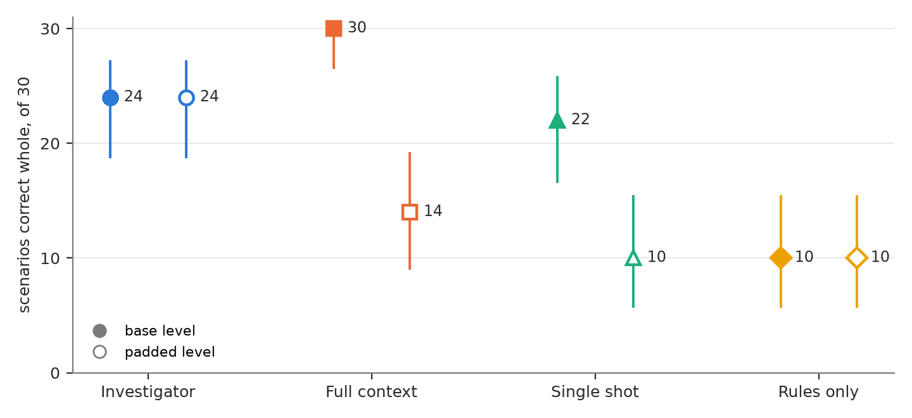
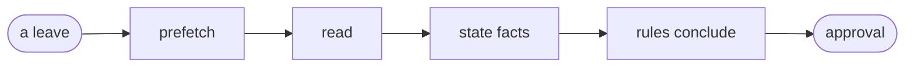
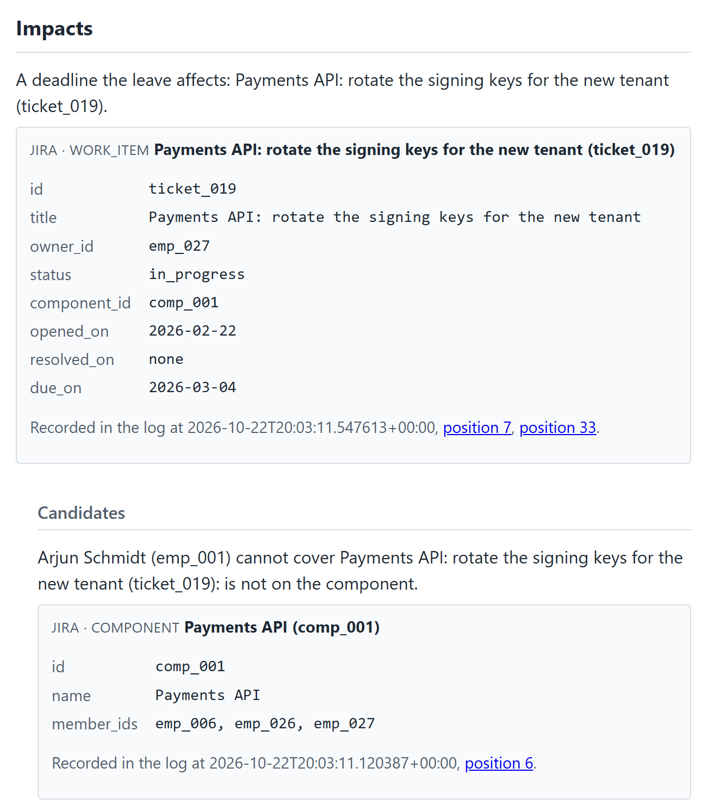

<div align="center">

# Leave Impact Agent

**What does one employee's leave actually affect, and can you check the answer
yourself?**

[](https://github.com/arda-basarici/leave-impact-agent/actions/workflows/ci.yml)
[](https://leave-agent.ardabasarici.dev)
[](report/where-the-single-call-stops.pdf)
[](LICENSE)


</div>

An LLM agent reads an organization's HR system, issue tracker, calendar and
documents, works out which deadlines and meetings a leave affects and who can
cover them, and drafts a coverage plan for a person to approve. Every claim in
the plan links to the record it was read from. The model reports facts and
quotes the text each one came from, and deterministic rules draw every
conclusion from those facts. The systems are real instances of Frappe HR, Jira
and Google Calendar. The organization inside them is synthetic and was
generated together with its answer key, so the agent is graded against a known
right answer.

*Solo, end to end: the benchmark, the agent, the evaluation, and the deployment
on AWS.*

> [!IMPORTANT]
> **Live: [leave-agent.ardabasarici.dev](https://leave-agent.ardabasarici.dev).**
> Read [one investigation with its evidence](https://leave-agent.ardabasarici.dev/replays/scenario-004),
> follow [the same run event by event](https://leave-agent.ardabasarici.dev/replays/scenario-004/timeline),
> or start a live run and decide on the plan it drafts. Live runs are capped at
> five a day, and [the ledger](https://leave-agent.ardabasarici.dev/ledger)
> shows what they have cost.

## The result

Four systems answered the same thirty leave scenarios at two corpus sizes. The
scenarios come in three tiers of ten: answerable from records alone, dependent
on facts that live only in prose, and built around a trap. The **base level**
is the organization's own documents, about 10,500 tokens when sent to a model
in one request. The **padded level** adds 160 filler documents and takes that
request to about 42,500 tokens. A scenario counts only when it is **correct
whole**: every required claim present and right, nothing unexpected claimed,
and no finding against the answer key in the plan.

The comparison was **registered**: written down with its analysis and frozen at
a commit before the world it was measured on was generated.

<div align="center">


*Scenarios correct whole, of thirty, with 95 percent Wilson intervals. Filled
marks are the base level, hollow marks the padded level.*
</div>

| System | Base level | Padded level |
|---|---:|---:|
| **Investigator**, a tool loop that reads in turns | 24 of 30 | **24 of 30** |
| Full context, one call shown every document | **30 of 30** | 14 of 30 |
| Single shot, one retrieval then one call | 22 of 30 | 10 of 30 |
| Rules only, no model | 10 of 30 | 10 of 30 |

At the base level the full-context system is correct on all thirty scenarios,
and the investigator on 24. At the padded level 24 of its 30 calls end at the
8,192-token output maximum with the list of facts cut off, and it falls to 14,
while the investigator stays at 24. The registered primary comparison is that
padded difference: 33 percentage points of scenarios, with an interval of 20 to
47 at 95 percent, paired by scenario.

Every system ran under the same output maximum. The one-call reader is asked to
list every fact in everything it was shown, so what it must write grows with
the corpus. The investigator lists the facts its searches returned.

The padded level exists because of an early probe. Before any model-reading
system was built, one call read a corpus of about ten thousand tokens and
reached the top score, which left a loop no room to do better. So a larger
level was added, and its size was fixed before the measurement world existed.

> **What this result is and is not.** One synthetic organization of 28 people,
> one model (Claude Haiku 4.5) in every system that calls one, one run per
> scenario, so the interval is over scenarios and says nothing about run-to-run
> variation. The padded size was chosen as the smallest candidate at which the
> single call failed on an earlier world used for development. The stop is a
> limit on what a call may write, and no evidence of a limit on what the model
> can read. A one-call reader with a larger output allowance, or one that wrote
> its answer over several calls, would face a different comparison. The two
> kinds of system were not tuned alike: the investigator's prompts went through
> fifteen development rounds and the one-call readers' instruction through four.
> The documents are near-template prose, so the result tests reading what is
> stated and not inference. The report's sixth chapter lists the rest of what
> this does not show.

Full write-up: [Where the Single Call Stops](report/where-the-single-call-stops.pdf)
(PDF) · the same table on [the demo's results page](https://leave-agent.ardabasarici.dev/results).

## How a run works



**prefetch**: the structured records of the HR system, the tracker and the
calendar, read once and then fixed for the run · **read**: the model reads in
turns, through tools scoped to its role and a full-text search over document
sections · **state facts**: one forced final call in which the model lists what
it read, each fact with its quote · **rules conclude**: deterministic rules
compose every claim and the coverage plan from the facts that pass the checks ·
**approval**: a live run waits for its visitor to approve or decline. A run
with no person present, such as a replay, records an automatic approval, and
the log marks it as automatic.

The loop is a LangGraph graph with its checkpoint in PostgreSQL. Every step is
also an event in one log, and that log is what recovery, the audit trail and
the public replays are read from. Below, part of one public replay: a deadline
the leave affects with the tracker record behind it, and a colleague ruled out
because the component's member list, shown under the claim, does not include
them.

<div align="center">

</div>

Going deeper from here: **[ARCHITECTURE](ARCHITECTURE.md)** is the tree as it
stands (how a run moves, the package ranks, how a world is built), and
**[DESIGN](DESIGN.md)** is the longer one, the decisions with the alternatives
that lost. Behind it, [DESIGN_RECORD](DESIGN_RECORD.md) keeps every decision as
it was recorded.

## The build, milestone by milestone

Two worlds appear below. The **golden world** was audited by hand, is one of
the worlds the agent was developed on, and is public with its answer keys. The
**measurement world** was generated from a secret seed after the procedure was
frozen. The result above comes from it, and it stays sealed.

| milestone | what shipped | the headline |
|---|---|---|
| the world, closed 2026-09-19 | a generator that builds the organization and thirty scenarios from a seed, writes them into live Frappe HR, Jira and Google Calendar, and seals the answer key where the application cannot read it; an independent validator; a hand-audit protocol | the golden world passed a hand audit of all thirty scenarios with no defect found in it |
| the investigator, closed 2026-10-17 | the agent on LangGraph over an event log, three baselines, an evaluator that grades claim by claim, and the registration | **24 of 30 against full context's 14** at the padded level; 240 registered runs for $9.96 of model spend |
| the demo, closed 2026-11-09 | the public site on one small AWS instance: thirty replays read from the runs' own records, the results page, and live runs a visitor starts and then approves or declines | live runs are on and capped; six have settled for $0.41 in all |
| the conversation, next | a manager questions an investigation, with answers grounded in the same evidence and evaluated on the same scenarios | not started |

## What was measured, and where each number stops

The entries behind these rows are in [`probes/FINDINGS.md`](probes/FINDINGS.md)
and the report.

| claim | measured | where it stops |
|---|---|---|
| the registered comparison | investigator **24 of 30**, full context **14 of 30** at the padded level; 33 points, paired interval 20 to 47 at 95 percent | thirty scenarios, one run each. Registered and then decided not run, before any result was seen: full context with a source system unavailable, and four supporting comparisons |
| why the single call stops | 24 of its 30 padded calls end at the 8,192-token output maximum, and 15 of its 16 failures had a stopped call | reported as output saturation, never as an input limit. One alternative instruction was probed in development and traded the stops for missed facts; nothing further was tried |
| where the investigator fails | six misses, the same six scenarios at both levels. Every document it needed was returned to the run; five needed facts were then not stated, and one was stated in a form the rules could not use | all six are in the prose-only tier. Six facts and six scenarios are different units, and the equal totals do not show a one-to-one match |
| what rules alone reach | 10 of 30, exactly the tier answerable from records | so twenty scenarios are where a system that reads documents can differ |
| the public replays | 26 of 30 correct whole when graded offline, $2.10 of model spend | the demo serves the golden world, which the agent was developed against, so this describes those runs and is no second result |
| a visitor's run | reserves $2.17 before its first model call and settles at six to seven cents | the six settled runs all came from the project's own acceptance sessions; the planned test with a stranger was skipped by a ruling, and no use by anyone outside is on record |
| backup and restore | the first nightly dump restored into a scratch database, where seven checks of seven passed | run once, by hand, on the same PostgreSQL service as the live database, so it proves the archive and not a fresh host; a recovery loses up to a day |
| one criterion not met | a run's events were to reach a viewer within 2 s at the 95th percentile; two runs read 2.0001 and 2.09 s | the measure carries the offset between two clocks, bounded only to 1.3 to 1.5 s, so it cannot resolve a two-second line; recorded as not met |

Dollar figures are the harness's own pricing from the registered price table
and have not been reconciled against the provider's bill.

## The engineering underneath

- **The answer key is out of the application's reach.** It sits in a bucket the
  application's AWS role has no permission on, and a probe after every deploy
  checks that a list and a read of it are refused. In the source, an import
  test keeps the agent and the web surface from importing the benchmark
  packages at all. The repository was searched for the sealed world's
  identifying hashes before the site went public, and the 124 public pages
  were crawled for them once it was up.
- **The model cannot conclude.** It reads, then lists facts with their quotes
  in one forced final call. The rules compose every claim and the plan from
  the facts that are admitted.
- **One event log is the authority.** Recovery after a crash, the audit trail,
  the run's export and the public timeline are all reads of the same log in
  PostgreSQL. A crash matrix in CI kills child processes at named points against
  the real database.
- **The measurement was registered first.** The procedure, the caps and the
  analysis were frozen at a commit before the measurement world was drawn. The
  evaluator runs under its own identity, reads exports and never re-reads a
  vendor. The report's tables are built from the committed results by a pinned
  build.
- **Spend is admitted before it is made.** A run takes its reservation against
  a ledger in the transaction that admits it. Visitors get five runs a day and
  two an address, one attempt on the host at a time, under a ceiling set by
  hand ($8 for the first public month).
- **Deploys hold no stored cloud keys.** After a required review the deploy job
  assumes a role through GitHub's OIDC trust, and that role may send commands
  only to instances carrying the application's tag, through Systems Manager.
- **Two things deliberately not built.** MCP was weighed and not chosen: one
  in-process consumer of a small owned read surface gains nothing from a
  protocol, and the question reopens with an external client that needs one. A
  vector retrieval arm was registered as a supporting comparison and decided
  not built at the freeze; retrieval is full-text search over document
  sections.

## Stack

| stack | where it earns its place |
|---|---|
| Python 3.13 · uv | a typed package; lint, types, unit tests and doctests gate every change |
| LangGraph | the investigator's loop: the graph orchestrates the tool turns and its interrupt carries the approval step. Chosen over a hand-rolled loop; the tools and the read ports know nothing of the framework, and recovery across processes comes from the event log, not the checkpoint |
| Amazon Bedrock | Claude Haiku 4.5 for every system that calls a model, through the Converse API |
| PostgreSQL · psycopg 3 | the event log, the spend ledger and the corpus the agent searches |
| FastAPI · Jinja2 · server-sent events | the demo: pages rendered on the server, a live run's timeline streamed |
| Docker · GitHub Actions · AWS | three containers on one instance, reviewer-gated workflows, deploys through OIDC and Systems Manager |
| Frappe HR · Jira · Google Calendar | the external systems a world is written into and the agent reads |

## Run the checks

Needs `uv`, `just` and Docker. None of these commands calls a model or a vendor
system; the rules-only baseline runs inside the unit tests on a throwaway
world.

```
uv sync                 # locked environment, dev tools included
just hooks              # once per clone: pre-commit (secret scan + lint)
just check              # the fast subset of CI: lint, types, unit tests + doctests, docs build
# set POSTGRES_PASSWORD (letters+digits) and PGDATA_HOST (absolute path) as user env vars, no .env
docker network create web   # once per machine: the proxy network the stack joins
just db-up              # dev PostgreSQL on 127.0.0.1:5432
just test-integration   # recorded vendor cassettes + the real PostgreSQL
just db-down
```

The integration level replays recorded HTTP cassettes of the three vendor
sandboxes, so it needs no credentials. `just --list` shows the rest.

## The benchmark workflows

A world that is written into the live systems is never generated from a
workstation or from the application's host. The three benchmark jobs are
dispatched GitHub workflows, each behind a reviewer-gated environment and each
under an AWS role of its own.

| workflow | environment | what its role may do |
|---|---|---|
| `generate world` | benchmark | write a world and its answer key |
| `validate world` | benchmark | read a world and the live systems; write only its verdict |
| `evaluate run` | evaluation | read the answer key and stored runs; write one evaluation artifact |

An operator's run is dispatched too (`investigate`, `continue run`), under the
same reviewer-gated production environment and role as the deploy. The 240
measured runs and the thirty replays were made that way. A visitor's run on the
demo needs no workflow.

## Layout

The package is `src/leaveimpact/`, eleven subpackages in five ranks. A module
never imports a higher rank.

| rank | packages | responsibility |
|---|---|---|
| 0 | `core` | the domain and its pure rules; imports nothing else in the package |
| 1 | `world` · `results` | the benchmark (organization, scenarios, truth, sealed artifacts) · the public results schema |
| 2 | `adapters` | one external boundary each: Frappe HR, Jira, Google Calendar, the document corpus, the models, the object store |
| 3 | `generator` · `validator` · `evaluator` · `cache` · `agent` | build a world · check what was written · grade a run · fill the corpus cache on the instance · the investigator, its three baselines and the run log |
| 4 | `launch` · `app` | admissions for an operator's run · the demo site and its worker |

A unit test holds the ranks and the edges denied on top of them.
[ARCHITECTURE](ARCHITECTURE.md) lists what that test holds and what rests on
review. Beside the package: `preregistration/` (the registration and the price
table), `probes/` (each probe and its outcome), `report/` (the report and its
build), `docs/golden-world/` (the golden world, released with its answer keys)
and `deploy/` (the instance's entrypoint and runbook). The host itself
(Terraform, the proxy, the backup units) is owned by the
[platform repository](https://github.com/arda-basarici/platform).

## What it demonstrates

An LLM agent built so that what it says can be checked and what it can cost is
bounded. Conclusions come from deterministic rules over facts the model quotes.
The agent is graded against an answer key generated with its world, in a
comparison frozen before the data existed. Spend is capped by a ledger, the
answer key is sealed from the application, and a plan is a draft until it is
approved.

## Development note

**Built with AI assistance, under review.** An AI coding agent wrote much of
the code, the tests and the documentation drafts. The design decisions, the
benchmark, the evaluation method and the hand audit of the golden world are the
author's, and review findings were reproduced on the source before they were
acted on.

## Deeper

[the live demo](https://leave-agent.ardabasarici.dev) ·
[the report](report/where-the-single-call-stops.pdf) ·
[DESIGN](DESIGN.md), the decisions and their reasoning ·
[DESIGN_RECORD](DESIGN_RECORD.md), the complete dated record ·
[ARCHITECTURE](ARCHITECTURE.md), the tree as it stands ·
[AUDIT_METHODOLOGY](AUDIT_METHODOLOGY.md), what "golden" means here ·
[FINDINGS](probes/FINDINGS.md), every probe's outcome ·
[the instance runbook](deploy/instance/README.md) ·
[REPORT_NOTES](REPORT_NOTES.md), the decision narratives ·
[VISION](VISION.md), the founding snapshot, frozen

## License

MIT, see [LICENSE](LICENSE). Single-author portfolio project; issues welcome.
